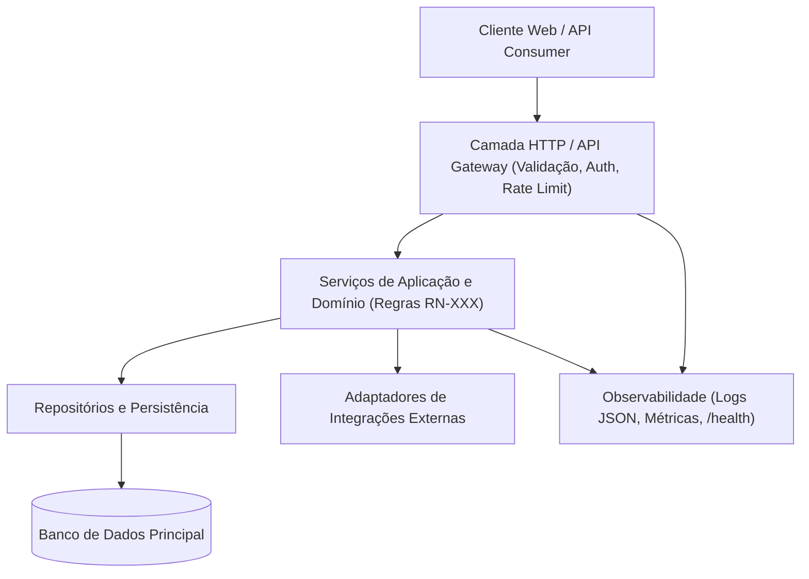

# Arquitetura do Sistema — Codit (`TCC-Codit`)

| Campo | Valor |
| :--- | :--- |
| **Projeto** | Codit (`TCC-Codit`) |
| **Status** | Em definição inicial (`Fase 0`) |
| **Última atualização** | `2026-11-22` |
| **Constituição relacionada** | [GEMINI.md](../GEMINI.md) |

---

## 1. Visão Geral e Princípios Arquiteturais

- **Objetivo Arquitetural:** `[Pendente de definição do escopo funcional do Codit]`
- **Princípios de Engenharia:**
  1. **Separação clara de responsabilidades:** camada de transporte/UI desacoplada das regras de domínio e da camada de persistência.
  2. **Contratos explícitos e tipagem estrita:** entradas e saídas validadas na fronteira da aplicação.
  3. **Falhas explícitas e observáveis:** tratamento padronizado de erros, timeouts definidos e logs estruturados.
  4. **Segurança e privacidade por padrão:** princípio do menor privilégio, proteção contra OWASP Top 10 e isolamento de segredos.

---

## 2. Requisitos Não-Funcionais (RNFs)

| Categoria | Requisito | Meta / SLA | Estratégia de Verificação |
| :--- | :--- | :--- | :--- |
| **Disponibilidade** | Operação contínua do serviço principal | `[Pendente de definição]` | Healthchecks (`/health`, `/ready`) e monitoramento |
| **Desempenho** | Latência de resposta p95 em rotas de API | `[Pendente de definição]` | Testes de carga e métricas de latência |
| **Segurança** | Autenticação, autorização RBAC e proteção de dados | Obrigatório | Testes de autorização, revisão OWASP e análise estática |
| **Observabilidade** | Rastreabilidade de requisições por `correlationId` | Obrigatório | Logs estruturados em JSON e inspeção de traces |
| **Escalabilidade** | Serviços stateless na camada de aplicação | `[Pendente de definição]` | Revisão arquitetural e ausência de estado em memória local |
| **Manutenibilidade** | Cobertura de testes automatizados e tipagem estrita | `[Pendente de definição]` | CI gates (`lint`, `typecheck`, `test`, `build`) |

---

## 3. Stack Tecnológica

> **Nota:** Nenhuma tecnologia será assumida sem decisão explícita registrada abaixo e vinculada a uma ADR.

| Camada | Tecnologia | Versão | Justificativa / ADR |
| :--- | :--- | :--- | :--- |
| **Frontend / UI** | `[Pendente de definição]` | `-` | `-` |
| **Backend / API** | `[Pendente de definição]` | `-` | `-` |
| **Banco de Dados** | `[Pendente de definição]` | `-` | Ver [banco-de-dados.md](./banco-de-dados.md) |
| **Cache / Filas (se aplicável)** | `[Pendente de definição]` | `-` | `-` |
| **Autenticação / Sessão** | `[Pendente de definição]` | `-` | `-` |
| **Testes Automatizados** | `[Pendente de definição]` | `-` | `-` |
| **Qualidade (Lint / Formatter)** | `[Pendente de definição]` | `-` | `-` |
| **CI/CD e Infraestrutura** | `[Pendente de definição]` | `-` | `-` |

---

## 4. Arquitetura de Camadas e Componentes

O diagrama abaixo representa a **arquitetura de referência inicial** para o Codit, sujeita a refinamento após a escolha da stack tecnológica:



### Responsabilidade das Camadas
- **Transporte / API:** parsing de requisição, autenticação, validação de schema de entrada, mapeamento de erros HTTP e serialização de resposta.
- **Aplicação e Domínio:** orquestração de casos de uso, invariantes das regras de negócio (`RN-XXX`), controle transacional e emissão de eventos de domínio.
- **Persistência:** acesso a dados, mapeamento relacional, consultas otimizadas e controle de concorrência (ver [banco-de-dados.md](./banco-de-dados.md)).
- **Integrações Externas:** clientes HTTP tipados com timeout, política de retry segura e fallback explícito.

---

## 5. Estrutura de Diretórios

### Estrutura Atual do Repositório (`2026-11-22`)

```text
TCC-Codit/
├── GEMINI.md
└── docs/
    ├── arquitetura.md
    ├── banco-de-dados.md
    ├── regras-negocio.md
    └── status.md
```

### Convenção Planejada (após definição da stack)

```text
TCC-Codit/
├── GEMINI.md
├── docs/                  # Documentação viva e ADRs
├── src/                   # Código-fonte da aplicação [Pendente de definição]
├── tests/                 # Testes unitários, integração e E2E [Pendente de definição]
├── infra/                 # Docker, scripts de deploy e IaC [Pendente de definição]
├── .env.example           # Contrato de variáveis de ambiente (sem valores secretos)
└── .github/workflows/     # Pipelines de CI/CD [Pendente de definição]
```

---

## 6. Contratos de API e Integrações Externas

### Padrões de API Interna
- **Versionamento:** rotas HTTP versionadas sob o prefixo `/api/v1/...`.
- **Formato de Dados:** JSON UTF-8 (`Content-Type: application/json`), datas em formato ISO-8601 UTC (`YYYY-MM-DDTHH:mm:ssZ`).
- **Paginação:** obrigatória em qualquer listagem aberta (limites mínimo/máximo definidos por endpoint).
- **Idempotência:** operações críticas de escrita/criação sujeitas a repetição devem suportar chave de idempotência (`Idempotency-Key`) e retornar resposta consistente sem duplicar efeito colateral.
- **Padronização de Erros (RFC 9457 — Problem Details):** toda resposta `4xx`/`5xx` deve usar `Content-Type: application/problem+json` no formato abaixo:

```json
{
  "type": "https://codit.local/errors/validation-error",
  "title": "Falha de validação dos dados enviados",
  "status": 422,
  "detail": "Um ou mais campos não atendem às regras de domínio.",
  "instance": "/api/v1/recurso",
  "traceId": "01J...",
  "errors": [
    {
      "field": "campo",
      "code": "RN-XXX",
      "message": "Descrição objetiva do erro"
    }
  ]
}
```

### Catálogo de Integrações Externas

| Serviço | URL Base | Endpoints Principais | Autenticação / Headers | Rate Limit & Timeout | Plano de Contingência |
| :--- | :--- | :--- | :--- | :--- | :--- |
| `[Pendente de definição]` | `-` | `-` | `-` | `-` | `-` |

> Toda nova integração adicionada nesta tabela deve especificar explicitamente formato de payload, tratamento de HTTP `429`/`5xx`, estratégia de cache ou fallback e custos/limites de API.

---

## 7. Segurança, Concorrência e Observabilidade

- **Segurança (OWASP Top 10):**
  - Validação estrita de entrada e sanitização na borda da API.
  - Autorização verificada no servidor em toda operação (nunca confiar apenas em validações no cliente).
  - CORS configurado por lista explícita de origens permitidas por ambiente.
  - Rate limiting em endpoints sensíveis (autenticação, recuperação de acesso, criação em massa).
  - Segredos gerenciados exclusivamente via variáveis de ambiente / cofre de segredos.
- **Concorrência e Resiliência:**
  - Operações com múltiplas escritas devem executar dentro de transação ACID.
  - Chamadas externas devem possuir timeout explícito; retentativas (exponential backoff + jitter) são permitidas apenas para falhas transitórias em operações idempotentes.
- **Observabilidade:**
  - Logs estruturados (JSON) contendo `timestamp`, `level`, `traceId`, `service`, `event` e duração, **nunca** registrando senhas, tokens ou dados sensíveis.
  - Endpoints operacionais obrigatórios:
    - `GET /health` (liveness: processo ativo).
    - `GET /ready` (readiness: dependências críticas, como banco de dados, acessíveis).

---

## 8. Ambiente Local, Operação e Validação

### Comandos Oficiais

| Ação | Comando | Observação |
| :--- | :--- | :--- |
| **Instalação / Setup** | `[Pendente de definição]` | Executar isoladamente em cada worktree |
| **Execução Local** | `[Pendente de definição]` | Requer `.env` baseado em `.env.example` |
| **Lint / Formatação** | `[Pendente de definição]` | Gate obrigatório pré-commit/CI |
| **Typecheck** | `[Pendente de definição]` | Gate obrigatório pré-commit/CI |
| **Testes Automatizados** | `[Pendente de definição]` | Inclui unitários e integração |
| **Build de Produção** | `[Pendente de definição]` | Verifica compilação e empacotamento |

### Nota sobre Git Worktrees (Orca)
- Arquivos e diretórios ignorados pelo Git (`.env`, dependências instaladas, caches de build) são isolados por worktree. Ao abrir um novo worktree em `C:/Users/gusta/orca/workspaces/TCC-Codit/<worktree>`, configure o `.env` e instale as dependências localmente antes de rodar os gates de validação.

---

## 9. Registro de Decisões Arquiteturais (ADRs)

### ADR-001 — Documentação viva orientada a agentes e desenvolvimento via Git Worktrees

- **Data:** `2026-11-22`
- **Status:** Aceita
- **Contexto:** O projeto Codit será desenvolvido com apoio de agentes de IA (Orca / Gemini) em workspaces isolados por tarefa. Sem uma fonte centralizada de verdade e regras claras de fluxo Git, agentes poderiam assumir requisitos implícitos ou gerar conflitos entre worktrees.
- **Decisão:** Adotar `GEMINI.md` na raiz do projeto como constituição operacional e manter `docs/arquitetura.md`, `docs/banco-de-dados.md`, `docs/regras-negocio.md` e `docs/status.md` como documentação viva obrigatória, aliada ao fluxo de Git Worktrees no Orca.
- **Consequências:**
  - *Positivas:* Rastreabilidade completa de decisões, menor risco de alucinação de requisitos e trabalho paralelo limpo por branch/worktree.
  - *Custos:* Exige disciplina para atualizar os arquivos `docs/` junto de cada entrega técnica.

### Template para Novas ADRs

```markdown
### ADR-XXX — Título da Decisão
- **Data:** YYYY-MM-DD
- **Status:** Proposta | Aceita | Substituída por ADR-YYY
- **Contexto:** Problema técnico ou de negócio que exige decisão.
- **Decisão:** Alternativa escolhida e justificativa objetiva.
- **Consequências:** Impactos positivos, trade-offs e ações necessárias.
```
