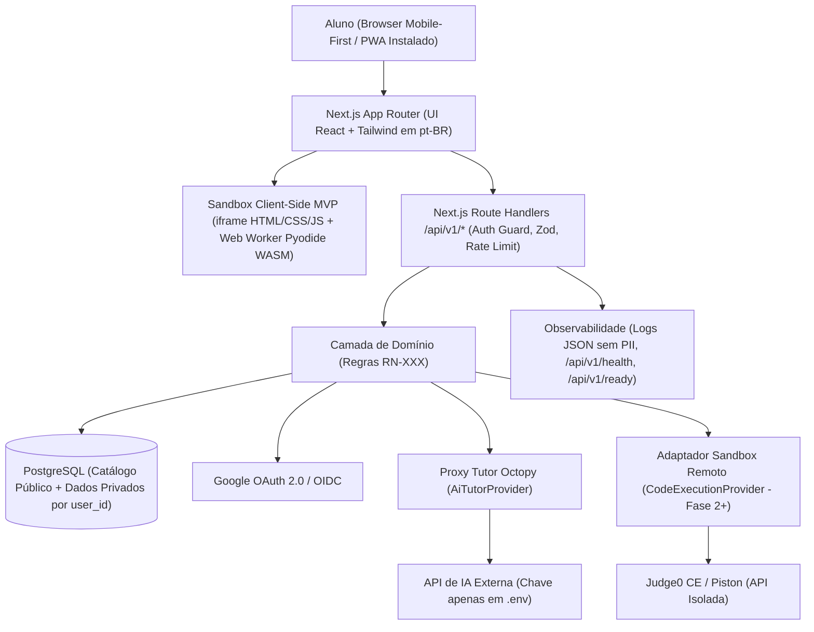

# Arquitetura do Sistema — Codit (`TCC-Codit`)

| Campo | Valor |
| :--- | :--- |
| **Projeto** | Codit (`TCC-Codit`) |
| **Estado Atual** | Base inicial + empacotamento multiplataforma configurados (`Fase 1` — Next.js App Router com exportação estática `out/` + TypeScript strict + Tailwind CSS + PWA + Tauri v2 + Capacitor 8 Android + `/api/v1/health`; ainda sem autenticação, banco, sandbox ou proxy do Octopy) |
| **Última atualização** | `2026-11-22` |
| **Guia Rápido** | [GEMINI.md](../GEMINI.md) |

---

## 1. Visão do Produto e Experiência Web Mobile-First + PWA

O **Codit** é uma plataforma SaaS educacional projetada para funcionar de forma fluida em celulares, tablets e desktops como **aplicação Web Responsiva Mobile-First** e **Progressive Web App (PWA) instalável**.

### Pilares de Conteúdo e Experiência
1. **Formação Técnica Completa (em `pt-BR`):** trilhas do básico ao avançado em programação, Inteligência Artificial aplicada, Git & GitHub e boas práticas de engenharia de mercado.
2. **Preparação para Carreira Tech:** construção de portfólio prático com mini-projetos, checklist de currículo/GitHub e preparação para entrevistas técnicas.
3. **Mascote e Tutor IA (`Octopy`):** polvo roxo interativo integrado às lições e ao editor de código para guiar o aluno com dicas socráticas graduais.
4. **Sandbox Prático Integrado:** execução segura de código diretamente no navegador no MVP, com arquitetura desacoplada para escalar a dezenas de linguagens no futuro.

### Estratégia PWA e Responsividade
- **Mobile-First:** layout pensado primeiro para telas estreitas (`360px+`), navegação acessível por polegar e editor de código responsivo adaptado para touch e desktop.
- **PWA Instalável:** `manifest.webmanifest` (ícones, `display: standalone`, `theme_color` alinhado à identidade visual do Codit/Octopy) e Service Worker para cache de shell estático e leitura offline de conteúdo já visitado.
- **Comportamento Offline Explícito:** recursos que exigem servidor (login, sincronização de progresso, tutor **Octopy** e sandbox remoto futuro) exibem estado claro de reconexão e enfileiramento seguro quando sem rede; o sandbox client-side já carregado continua operante no dispositivo.

---

## 2. Stack Tecnológica Alvo (Planejada)

> **Estado das dependências:** O scaffold base conta com `Next.js 16.4.6`, `React 19.3.1`, `TypeScript 5.9.3`, `Tailwind CSS 4.3.5`, `zod`, `server-only`, `eslint`, `vitest`, pacotes Tauri v2 (`@tauri-apps/cli`, `@tauri-apps/api`, `@tauri-apps/plugin-updater`, `@tauri-apps/plugin-process`) e pacotes Capacitor 8 (`@capacitor/core`, `@capacitor/cli`, `@capacitor/android`) instalados em `package.json`. Os itens marcados com `DEC-XXX` (ORM/PostgreSQL, Auth e provedor LLM do Octopy) aguardam decisão final antes de serem instalados.

| Camada | Tecnologia Planejada | Observações / Decisão |
| :--- | :--- | :--- |
| **Linguagem** | TypeScript (`strict: true`) | Ponta a ponta (frontend, API routes, validação e camada de dados) |
| **Framework Full-Stack / UI** | Next.js (App Router) + React | Renderização híbrida (RSC + Client Components interativos para Sandbox/Octopy) e exportação estática `out/` para empacotamento nativo |
| **Estilização** | Tailwind CSS | Design system responsivo Mobile-First e suporte a tema escuro/claro |
| **PWA** | Web App Manifest + Service Worker | Instalação em Android/iOS/Desktop e cache seguro de assets públicos (nunca cachear rotas autenticadas privadas no SW compartilhado) |
| **Empacotamento Desktop (Windows)** | Tauri v2 (`com.codit.app`) | Shell nativo WebView2 sobre `out/`, com `tauri-plugin-updater` e `tauri-plugin-process` pré-configurados para atualizações via pop-up |
| **Empacotamento Mobile (Android)** | Capacitor 8 (`com.codit.app`) | Projeto nativo Android em `android/` empacotando `out/` via `npx cap sync android` para geração de `.apk`/`.aab` |
| **Banco de Dados** | PostgreSQL (`16+` alvo) | Isolamento rigoroso por `user_id` + suporte a Row-Level Security (RLS) |
| **ORM / Migrações** | `[Em aberto — DEC-001]` | Avaliar Prisma vs. Drizzle ORM |
| **Autenticação** | Cadastro/Login tradicional + Google OAuth 2.0 | Sessões seguras `HttpOnly`; biblioteca a fechar em `DEC-003` |
| **Tutor IA (`Octopy`)** | API LLM via proxy server-side (`DEC-002`) | Streaming SSE; suporte primário/contingência via interface `AiTutorProvider` |
| **Sandbox MVP** | `iframe` sandboxed (HTML/CSS/JS) + Pyodide WASM (Python) | Execução 100% client-side em Web Worker / iframe isolado |
| **Sandbox Escalável (Fase 2+)** | API externa isolada (`CodeExecutionProvider`) | Adaptador para Judge0 CE ou Piston (ou container self-hosted) |

---

## 3. Arquitetura de Alto Nível



---

## 4. Arquitetura do Sandbox de Código (Zero RCE no Servidor Principal)

Regra inegociável de segurança: **código arbitrário enviado por alunos jamais é executado dentro do processo Node.js/Next.js do servidor principal**.

### Fase 1 (MVP — Execução 100% Client-Side)

| Linguagem | Mecanismo de Isolamento | Controles de Segurança e Limites |
| :--- | :--- | :--- |
| **HTML / CSS / JavaScript** | `<iframe sandbox="allow-scripts">` (**proibido** `allow-same-origin`) | Origem opaca (`null`), sem acesso a cookies/`localStorage`/DOM do Codit; CSP restritiva; captura de `console` e erros via `postMessage` validado; watchdog de timeout para encerrar o iframe em caso de travamento |
| **Python** | **Pyodide (WebAssembly)** rodando dentro de **Web Worker dedicado** | Sem acesso ao DOM da aplicação principal; sistema de arquivos virtual efêmero em memória (`MEMFS`); proteção contra loop infinito via timeout no host que chama `worker.terminate()` e reinicia o worker; limite de caracteres de `stdout`/`stderr` |

### Fase 2+ (Expansão Multi-Linguagem via `CodeExecutionProvider`)

Para suportar linguagens compiladas ou fora do navegador (ex.: TypeScript avançado/Node, Java, C/C++, Go, Rust, SQL interativo), o backend exporá `POST /api/v1/sandbox/execute` usando o padrão **Adapter (`CodeExecutionProvider`)**, com chaves e URLs exclusivamente em `.env` no servidor:

#### Opção Primária Planejada: Judge0 CE
- **URLs base oficiais:** `https://ce.judge0.com` (instância pública comunitária, sujeita a limites) · `https://judge0-ce.p.rapidapi.com` (RapidAPI) · ou URL própria via self-hosting Docker.
- **Endpoints:**
  - Criar submissão: `POST /submissions?base64_encoded=true&wait=false`
  - Consultar resultado (polling controlado pelo backend): `GET /submissions/{token}?base64_encoded=true&fields=stdout,stderr,compile_output,message,status,time,memory`
- **Headers (server-side):** `Content-Type: application/json` + `X-Auth-Token` (self-hosted) ou `X-RapidAPI-Key` e `X-RapidAPI-Host` (RapidAPI).
- **Payload mínimo:**
  ```json
  {
    "source_code": "<base64>",
    "language_id": 71,
    "stdin": "<base64>",
    "cpu_time_limit": 2.0,
    "wall_time_limit": 5.0,
    "memory_limit": 128000
  }
  ```

#### Opção Alternativa / Contingência: Piston
- **URL base oficial:** `https://emkc.org/api/v2/piston` (API pública com rate limit) ou container self-hosted.
- **Endpoints:** `GET /runtimes` · `POST /execute`.
- **Payload mínimo:**
  ```json
  {
    "language": "python",
    "version": "3.10.0",
    "files": [{ "name": "main.py", "content": "print('Codit')" }],
    "stdin": "",
    "compile_timeout": 5000,
    "run_timeout": 3000
  }
  ```

#### Plano de Contingência do Sandbox
1. Se o provedor remoto retornar HTTP `429`, `5xx` ou exceder orçamento/quota, as linguagens do núcleo (**HTML, CSS, JS e Python**) continuam operando **100% client-side** sem degradação.
2. Para linguagens exclusivamente remotas, retornar HTTP `503` em formato RFC 9457 informando indisponibilidade temporária com alternativa self-hosted (Judge0/Piston em container isolado com `cgroups`, `seccomp`, sem acesso à rede interna).

---

## 5. Arquitetura do Tutor IA (`Octopy`)

O **Octopy** é o mascote e tutor interativo do Codit, operando exclusivamente atrás de um proxy autenticado no backend (`POST /api/v1/octopy/chat`).

### Fluxo e Proteções
1. **Autenticação e Rate Limit:** apenas usuários autenticados acessam o proxy, com cotas por `user_id` (janela deslizante por minuto e cota diária).
2. **Pedagogia Socrática Server-Side:** o `system prompt` do Octopy reside exclusivamente no servidor (nunca enviado ou editável pelo cliente) e instrui a IA a fornecer dicas progressivas (`hint_level` 1 → 2 → 3) sem entregar a solução completa na primeira dúvida.
3. **Mitigação de Prompt Injection:** o código do aluno no Sandbox e o enunciado do exercício são enviados em blocos delimitados e tratados como dados não confiáveis.
4. **Streaming:** resposta via SSE (`text/event-stream`) para percepção rápida de resposta em dispositivos móveis.

### Contrato `AiTutorProvider` e Plano de Contingência
- **Provedores suportados via variável de ambiente (`DEC-002`):**
  - *Gemini API:* `POST https://generativelanguage.googleapis.com/v1beta/models/{model}:streamGenerateContent?alt=sse` · header `x-goog-api-key: <GEMINI_API_KEY>`.
  - *OpenAI Responses API:* `POST https://api.openai.com/v1/responses` · header `Authorization: Bearer <OPENAI_API_KEY>`.
- **Contingência (APIs pagas, timeout ou HTTP `429`):**
  1. Fallback automático para modelo mais leve/econômico ou provedor secundário configurado em `.env`.
  2. Se todos os provedores de IA falharem ou a cota gratuita/mensal esgotar, o serviço entrega **dicas estáticas pré-curadas** vinculadas à `lesson_id`/`exercise_id` no PostgreSQL, mantendo o aluno desbloqueado sem expor stack traces.

---

## 6. Autenticação, Google OAuth 2.0 e Segurança de Segredos

### Fluxo Duplo de Autenticação
- **Tradicional (E-mail e Senha):**
  - Hash de senha com `Argon2id` (preferencial) ou `bcrypt` com custo adequado; comparação em tempo constante.
  - Política mínima de senha forte, proteção contra força bruta (rate limit por IP + conta) e verificação de e-mail antes de vinculações sensíveis.
- **Google OAuth 2.0 / OpenID Connect:**
  - Discovery oficial: `https://accounts.google.com/.well-known/openid-configuration`
  - Autorização: `https://accounts.google.com/o/oauth2/v2/auth` (escopos mínimos `openid email profile`, com `state` anti-CSRF e **PKCE `S256`**).
  - Troca de código (server-side): `POST https://oauth2.googleapis.com/token` (usando `GOOGLE_CLIENT_ID` e `GOOGLE_CLIENT_SECRET`).
  - Perfil/Validação: verificação do `id_token` (assinatura JWKS, `iss`, `aud`, `exp`) e/ou `GET https://openidconnect.googleapis.com/v1/userinfo`.
  - **Regra anti-account-takeover:** vinculação automática entre conta local e conta Google pelo mesmo e-mail só ocorre se `email_verified === true` em ambos os provedores.
- **Sessão:** cookie `HttpOnly`, `Secure` (em HTTPS), `SameSite=Lax`, com token opaco armazenado via hash no banco (`user_sessions`) ou JWT assinado com rotação/revogação suportada.

### Gestão de Variáveis de Ambiente (`.env`)
Nenhuma chave secreta pode usar prefixo `NEXT_PUBLIC_*` ou ser commitada. A aplicação deve validar na inicialização (*fail-fast*):

| Variável (Server-Side) | Finalidade | Obrigatória |
| :--- | :--- | :--- |
| `DATABASE_URL` | String de conexão PostgreSQL | Sim |
| `AUTH_SECRET` | Segredo criptográfico para assinatura de sessões/cookies (min. 32 bytes) | Sim |
| `APP_BASE_URL` | URL canônica da aplicação (callbacks OAuth e links) | Sim |
| `GOOGLE_CLIENT_ID` | Client ID OAuth 2.0 (Google Cloud Console) | Para OAuth |
| `GOOGLE_CLIENT_SECRET` | Client Secret OAuth 2.0 (estritamente server-side) | Para OAuth |
| `AI_PROVIDER_API_KEY` | Chave da API de IA do tutor Octopy | Para Octopy |
| `SANDBOX_API_URL` / `SANDBOX_API_KEY` | URL e chave do sandbox remoto (Fase 2+) | Apenas Fase 2+ |

---

## 7. Contratos de API Interna (`/api/v1`) e Padrão de Erros

- **Convenção de Rotas (em inglês):**
  - `POST /api/v1/auth/register`, `POST /api/v1/auth/login`, `POST /api/v1/auth/logout`, `GET /api/v1/auth/google`, `GET /api/v1/auth/google/callback`
  - `GET /api/v1/tracks`, `GET /api/v1/tracks/:slug`
  - `PUT /api/v1/lessons/:lessonId/progress`
  - `POST /api/v1/exercises/:exerciseId/submissions`
  - `GET /api/v1/projects`, `POST /api/v1/projects`, `GET /api/v1/projects/:projectId`, `PATCH /api/v1/projects/:projectId`, `DELETE /api/v1/projects/:projectId`
  - `POST /api/v1/octopy/chat`, `GET /api/v1/octopy/conversations`
  - `POST /api/v1/sandbox/execute` *(Fase 2+)*
  - `GET /api/v1/health` (liveness) e `GET /api/v1/ready` (readiness com verificação de PostgreSQL)
- **Formato de Erros (RFC 9457 — `application/problem+json`):**

```json
{
  "type": "https://codit.app/errors/forbidden-resource",
  "title": "Acesso negado ao recurso",
  "status": 403,
  "detail": "Você não possui permissão para acessar este mini-projeto.",
  "instance": "/api/v1/projects/0193...",
  "traceId": "req_01J..."
}
```

- **Concorrência e Idempotência:** rotas de progresso e criação aceitam `Idempotency-Key`; edições de mini-projetos usam lock otimista (`version`) retornando HTTP `409 Conflict` em caso de edição concorrente.

---

## 8. Empacotamento Multiplataforma Nativo (Web/PWA, Tauri v2 e Capacitor Android)

A mesma base TypeScript/React do Codit alimenta três canais de distribuição a partir da exportação estática do Next.js em `out/`, sem duplicação de código de interface:

| Alvo | Tecnologia | Identificador / Entrada | Diretório Web Consumido | Scripts `package.json` |
| :--- | :--- | :--- | :--- | :--- |
| **Web / PWA** | Next.js App Router | `npm run dev` / deploy server-side (`CODIT_BUILD_TARGET=server`) ou estático | `.next/` / `out/` | `dev`, `build`, `start` |
| **Desktop Windows (`.exe`)** | Tauri v2 (`src-tauri/`) | `com.codit.app` · janela `Codit` (`1280x800`, mín. `375x640`) | `../out` (`devUrl: http://localhost:3000`) | `tauri:dev`, `tauri:build` |
| **Mobile Android (`.apk`)** | Capacitor 8 (`android/`) | `com.codit.app` · `Codit` (`androidScheme: https`) | `out` (`capacitor.config.ts`) | `android:sync`, `android:open` |

### Estratégia do `next.config.ts` e Hardening Multiplataforma
- **`npm run dev` (`PHASE_DEVELOPMENT_SERVER`):** executa sem `output: "export"`, mantendo `headers()` de segurança (`X-Content-Type-Options`, `X-Frame-Options`, `Referrer-Policy`, `Permissions-Policy`, `Content-Security-Policy` de desenvolvimento, `/sw.js`, `/manifest.webmanifest`) e Route Handlers dinâmicos em desenvolvimento local.
- **`npm run build` (padrão):** ativa `output: "export"` e `images: { unoptimized: true }`, omitindo `headers()` (não suportado em export estático) para gerar `out/` limpo e sem avisos. O endpoint `GET /api/v1/health` usa `export const dynamic = "force-static"` para permanecer compatível com a exportação estática. Ao hospedar `out/` em CDN ou servidor estático, **configure cabeçalhos equivalentes** (`Content-Security-Policy`, `Strict-Transport-Security`, `X-Content-Type-Options`, `X-Frame-Options`, `Referrer-Policy`, `Permissions-Policy`) diretamente na borda do provedor.
- **`CODIT_BUILD_TARGET=server`:** reservado para builds SSR/backend Web com Route Handlers dinâmicos (`/api/v1/*`) quando autenticação, PostgreSQL e proxy do Octopy entrarem na Fase 2+, aplicando `Content-Security-Policy` e `Strict-Transport-Security` de produção via `next.config.ts`.
- **Hardening Desktop (Tauri v2):** [tauri.conf.json](../src-tauri/tauri.conf.json) define `app.security.csp` restritiva em produção e `app.security.devCsp` em desenvolvimento, permitindo somente o IPC interno do Tauri (`ipc:` / `http://ipc.localhost` / `https://ipc.localhost`) e assets empacotados.
- **Hardening Android (Capacitor 8):** [AndroidManifest.xml](../android/app/src/main/AndroidManifest.xml) define `android:allowBackup="false"`, `android:usesCleartextTraffic="false"` e `network_security_config.xml` bloqueando HTTP em texto claro; [build.gradle](../android/app/build.gradle) ativa R8 (`minifyEnabled true`, `shrinkResources true`) em `release` e [file_paths.xml](../android/app/src/main/res/xml/file_paths.xml) limita o `FileProvider` a `cache-path` (`shared/`).
- **Service Worker em WebViews nativas:** [service-worker-register.tsx](../src/components/pwa/service-worker-register.tsx) detecta `__TAURI_INTERNALS__` e `Capacitor.isNativePlatform()` para não registrar `sw.js` dentro dos apps `.exe` e `.apk`, evitando cache obsoleto sobre assets locais empacotados.
- **Segurança de segredos em clientes empacotados:** assim como no navegador Web, variáveis sensíveis (`.env`, `DATABASE_URL`, `AUTH_SECRET`, `GOOGLE_CLIENT_SECRET`, `AI_PROVIDER_API_KEY`) **nunca** entram no bundle `out/`, no binário Tauri ou no APK Android; todas as chamadas autenticadas e de IA apontarão para o backend remoto via HTTPS.

### Atualização Automática no Desktop (`tauri-plugin-updater`)
- **Backend Rust (`src-tauri/`):** `Cargo.toml` inclui `tauri-plugin-updater = "2"` (somente alvos desktop) e `tauri-plugin-process = "2"`; `src-tauri/capabilities/default.json` concede `"updater:default"` e `"process:default"` à janela `main`; `src-tauri/src/lib.rs` ativa o plugin quando `plugins.updater.pubkey` estiver preenchida em `tauri.conf.json`.
- **Cliente TypeScript:** [desktop-updater.ts](../src/lib/desktop-updater.ts) expõe `isTauriDesktop()`, `checkForDesktopUpdate()` e `relaunchDesktopApp()` usando imports dinâmicos para futura UI de pop-up de atualização sem impactar o bundle Web/Android.
- **Ativação de assinatura para release:**
  1. Gerar par de chaves Ed25519/minisign com `npx tauri signer generate -w ~/.tauri/codit.key`.
  2. Preencher `plugins.updater.pubkey` e ajustar `bundle.createUpdaterArtifacts: true` em [tauri.conf.json](../src-tauri/tauri.conf.json).
  3. Exportar `TAURI_SIGNING_PRIVATE_KEY` (e `TAURI_SIGNING_PRIVATE_KEY_PASSWORD`, se houver) antes de rodar `npm run tauri:build`.

### Pré-requisitos de Toolchain por Plataforma
- **Windows Desktop (`.exe` via Tauri v2):** Rust + Cargo (`rustup`), Microsoft C++ Build Tools (MSVC + Windows SDK) e Microsoft Edge WebView2 Runtime.
- **Android Mobile (`.apk` via Capacitor 8):** Java JDK 21 (`JAVA_HOME`) e Android Studio / Android SDK (`ANDROID_HOME`, SDK API 36 / `minSdk` 24).

---

## 9. Estrutura de Diretórios (Atual vs. Planejada)

### Atual (`2026-11-22` — Base Inicial Fase 1 + Setup Multiplataforma)
```text
TCC-Codit/
├── GEMINI.md
├── .env.example               # Contrato de variáveis server-side sem segredos
├── .gitignore                 # Ignora out/, src-tauri/target/, android/app/build/ e artefatos locais
├── capacitor.config.ts        # Configuração Capacitor 8 (com.codit.app, webDir: "out")
├── eslint.config.mjs
├── next.config.ts             # Exportação estática out/ + dev server com headers de segurança
├── package.json               # Scripts dev/build + tauri:dev/build + android:sync/open
├── postcss.config.mjs
├── tsconfig.json
├── vitest.config.ts
├── android/                   # Projeto nativo Android gerado pelo Capacitor (configuração versionada)
├── src-tauri/                 # Backend desktop Tauri v2 (Cargo.toml, tauri.conf.json, capabilities, ícones, src/)
├── docs/
│   ├── arquitetura.md
│   ├── banco-de-dados.md
│   ├── regras-negocio.md
│   └── status.md
├── public/
│   ├── icons/                 # Ícones PNG PWA + octopy-mark.svg
│   ├── manifest.webmanifest
│   └── sw.js                  # Service Worker seguro (nunca cacheia /api/*)
├── src/
│   ├── app/                   # App Router (UI pt-BR, /offline, /api/v1/health)
│   ├── components/            # Brand (OctopyBadge) e PWA (SW, Banner, Reload)
│   └── lib/                   # env.ts, problem-details.ts, logger.ts, desktop-updater.ts
└── tests/
    ├── mocks/
    └── unit/                  # Testes unitários Vitest (env, problem-details, health)
```

### Planejada (Expansão Fases 2–4)
```text
TCC-Codit/
├── GEMINI.md
├── capacitor.config.ts        # Empacotamento Android
├── src-tauri/                 # Empacotamento Desktop Windows + updater
├── android/                   # Projeto Android Studio / Gradle
├── docs/                      # Documentação viva e ADRs
├── public/                    # Ícones PWA, manifest.webmanifest, sw.js e assets
├── src/
│   ├── app/                   # Páginas autenticadas e rotas /api/v1/* (Auth, Tracks, Octopy)
│   ├── components/            # Componentes React Mobile-First (Editor, Preview, Octopy)
│   ├── modules/               # Domínios desacoplados (auth, curriculum, sandbox, octopy, career)
│   ├── lib/                   # Validação env, DB client, logger JSON, erros RFC 9457, desktop-updater
│   └── workers/               # Web Workers client-side (ex.: Pyodide runner)
├── tests/                     # Testes unitários, integração e E2E
├── .env.example               # Contrato de variáveis sem segredos
└── package.json
```

---

## 10. Registro de Decisões Arquiteturais (ADRs)

- **ADR-001 (Aceita — 2026-11-22):** Adoção de TypeScript ponta a ponta com Next.js App Router + Tailwind CSS + PostgreSQL e documentação viva (`GEMINI.md` + `docs/`) com fluxo isolado por Git Worktrees no Orca.
- **ADR-002 (Aceita — 2026-11-22):** Execução de código no MVP 100% client-side (`iframe` sandboxed sem `allow-same-origin` para HTML/CSS/JS; Pyodide WASM em Web Worker para Python) + adaptador `CodeExecutionProvider` para Judge0/Piston em fases futuras, proibindo execução arbitrária no servidor principal.
- **ADR-003 (Aceita — 2026-11-22):** Tutor IA **Octopy** operado exclusivamente via proxy server-side (`/api/v1/octopy/chat`) com system prompt protegido, cotas por `user_id` e fallback para dicas estáticas pré-curadas.
- **ADR-004 (Aceita — 2026-11-22):** Convenção bilíngue estrita — código, rotas, identificadores e esquema PostgreSQL em **inglês**; interface, mensagens e conteúdo educacional em **português (`pt-BR`)**.
- **ADR-005 (Aceita — 2026-11-22):** Empacotamento multiplataforma nativo sobre uma única base TypeScript/React usando exportação estática compartilhada (`out/`) com **Tauri v2** (`.exe` Windows + `tauri-plugin-updater` pré-configurado) e **Capacitor 8** (`.apk` Android), mantendo `npm run dev` e builds server-side futuros (`CODIT_BUILD_TARGET=server`) preservados e segredos estritamente fora dos pacotes cliente.
