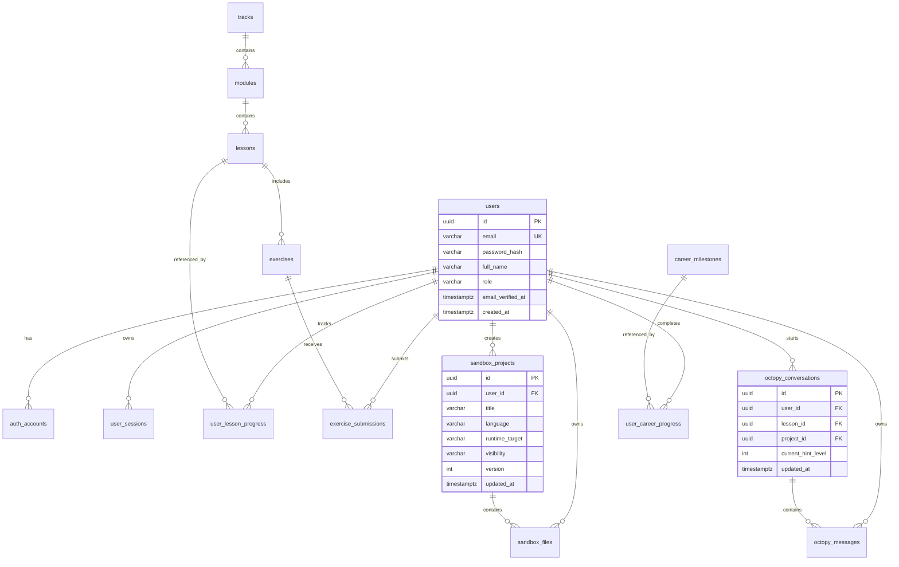

# Banco de Dados e Modelagem — Codit (`TCC-Codit`)

| Campo | Valor |
| :--- | :--- |
| **Projeto** | Codit (`TCC-Codit`) |
| **SGBD Alvo** | PostgreSQL (`16+` planejado — **sem migrações ou ORM instalados ainda**) |
| **Última atualização** | `2026-11-22` |
| **Documentos relacionados** | [GEMINI.md](../GEMINI.md) · [arquitetura.md](./arquitetura.md) · [regras-negocio.md](./regras-negocio.md) |

---

## 1. Configuração e Convenções Gerais

| Aspecto | Padrão Definido | Observações |
| :--- | :--- | :--- |
| **Idioma do Schema** | **Inglês (`snake_case`)** | Tabelas no plural, colunas, constraints e índices em inglês |
| **Chaves Primárias (PK)** | `UUID` (preferencial `UUIDv7` ou `gen_random_uuid()`) | Evita enumeração de IDs em URLs/APIs públicas |
| **Timestamps** | `TIMESTAMPTZ` em **UTC** | Toda tabela principal possui `created_at` e `updated_at` (e `deleted_at` onde houver exclusão lógica) |
| **Prefixos de Constraints** | `pk_`, `fk_`, `uq_`, `idx_`, `chk_` | Padronização para leitura clara em logs de erro e migrações |
| **Integridade Referencial** | `ON DELETE RESTRICT` por padrão | Evita exclusões em cascata acidentais; `CASCADE` apenas em vínculos estritamente dependentes (sessões, arquivos de um projeto excluído definitivamente) |
| **ORM / Migrações** | `[Em aberto — DEC-001]` | Prisma ORM ou Drizzle ORM + SQL migrations versionadas |

---

## 2. Regra de Ouro: Isolamento Rigoroso por `user_id`

Toda tabela do **Codit** pertence a exatamente uma de duas categorias:

1. **Catálogo Curricular Público/Compartilhado:** conteúdo pedagógico criado pela plataforma (`tracks`, `modules`, `lessons`, `exercises`, `career_milestones`). Leitura pública/autenticada; escrita restrita ao papel `admin`.
2. **Dados Privados do Usuário (Obrigatório `user_id`):** todos os registros gerados pelo aluno possuem coluna obrigatória `user_id UUID NOT NULL REFERENCES users(id)`:
   - `auth_accounts` e `user_sessions`
   - `user_lesson_progress` e `exercise_submissions`
   - `sandbox_projects` e `sandbox_files`
   - `octopy_conversations` e `octopy_messages`
   - `user_career_progress`

### Defesa em Profundidade (Aplicação + PostgreSQL RLS)
- **Camada de Aplicação/Repositório:** toda consulta e mutação em tabelas privadas **deve** receber o `userId` extraído da sessão validada no servidor (nunca confiado do body/query) e filtrar explicitamente `WHERE user_id = :sessionUserId`.
- **PostgreSQL Row-Level Security (RLS):** planejado para habilitar RLS nas tabelas privadas usando `current_setting('app.current_user_id', true)::uuid`, garantindo isolamento no próprio SGBD mesmo em caso de falha humana em alguma query.
- **Exceção controlada para Portfólio:** um mini-projeto em `sandbox_projects` com `visibility IN ('unlisted', 'public_portfolio')` pode ser lido por terceiros em modo **somente leitura** por rota pública dedicada, mantendo edição/exclusão restritas ao dono (`user_id`).

---

## 3. Diagrama Entidade-Relacionamento (DER)

---

## 4. Dicionário de Dados Planejado

### 4.1 Identidade e Autenticação

#### `users`
- **Propósito:** Conta principal do aluno ou administrador na plataforma.
- **Regras associadas:** `RN-001`, `RN-002`, `RN-003`

| Coluna | Tipo | Nulo | Default / Restrição | Descrição |
| :--- | :--- | :--- | :--- | :--- |
| `id` | `UUID` | Não | `PK` | Identificador único do usuário (`user_id` global) |
| `email` | `VARCHAR(255)` | Não | `UQ` (case-insensitive) | E-mail principal normalizado em minúsculas |
| `password_hash` | `TEXT` | Sim | `-` | Hash `Argon2id`/`bcrypt`; nulo para contas criadas apenas via Google OAuth |
| `full_name` | `VARCHAR(120)` | Não | `-` | Nome de exibição do usuário |
| `avatar_url` | `TEXT` | Sim | `-` | URL sanitizada de foto de perfil |
| `role` | `VARCHAR(20)` | Não | `'student'` (`chk_users_role`) | Papel RBAC (`student`, `admin`) |
| `email_verified_at` | `TIMESTAMPTZ` | Sim | `NULL` | Data/hora UTC da verificação do e-mail |
| `is_active` | `BOOLEAN` | Não | `TRUE` | Controle de suspensão/desativação imediata |
| `created_at` | `TIMESTAMPTZ` | Não | `NOW()` | Criação em UTC |
| `updated_at` | `TIMESTAMPTZ` | Não | `NOW()` | Última atualização em UTC |
| `deleted_at` | `TIMESTAMPTZ` | Sim | `NULL` | Exclusão lógica/anonimização LGPD |

#### `auth_accounts`
- **Propósito:** Vínculos de provedores externos (ex.: Google OAuth 2.0) associados a um `user_id`.

| Coluna | Tipo | Nulo | Restrição | Descrição |
| :--- | :--- | :--- | :--- | :--- |
| `id` | `UUID` | Não | `PK` | Identificador do vínculo |
| `user_id` | `UUID` | Não | `FK -> users(id)` | Dono da conta vinculada |
| `provider` | `VARCHAR(30)` | Não | `uq_auth_provider_sub` | Provedor (`google`, etc.) |
| `provider_account_id` | `VARCHAR(255)` | Não | `uq_auth_provider_sub` | Claim `sub` imutável do provedor OIDC |
| `created_at` | `TIMESTAMPTZ` | Não | `NOW()` | Data do vínculo |

#### `user_sessions`
- **Propósito:** Controle explícito de sessões ativas para suportar logout e revogação imediata.

| Coluna | Tipo | Nulo | Restrição | Descrição |
| :--- | :--- | :--- | :--- | :--- |
| `id` | `UUID` | Não | `PK` | Identificador da sessão |
| `user_id` | `UUID` | Não | `FK -> users(id)` | Usuário dono da sessão |
| `token_hash` | `CHAR(64)` | Não | `UQ` | Hash `SHA-256` do token de sessão (nunca salvar token puro) |
| `expires_at` | `TIMESTAMPTZ` | Não | `-` | Expiração absoluta em UTC |
| `revoked_at` | `TIMESTAMPTZ` | Sim | `NULL` | Preenchido no logout ou revogação de segurança |
| `user_agent` | `VARCHAR(255)` | Sim | `-` | Metadado básico de dispositivo para auditoria |
| `created_at` | `TIMESTAMPTZ` | Não | `NOW()` | Criação da sessão |

---

### 4.2 Catálogo Educacional (Conteúdo em `pt-BR`) e Progresso

#### `tracks`, `modules`, `lessons`, `exercises` (Catálogo Compartilhado)

| Tabela | Colunas Chave | Propósito |
| :--- | :--- | :--- |
| `tracks` | `id`, `slug` (`UQ`), `title`, `category` (`programming`, `ai`, `git_github`, `best_practices`, `career`), `level` (`beginner`, `intermediate`, `advanced`), `order_index`, `is_published` | Trilhas principais do Codit |
| `modules` | `id`, `track_id` (`FK -> tracks`), `slug`, `title`, `order_index` | Agrupamento temático dentro de uma trilha |
| `lessons` | `id`, `module_id` (`FK -> modules`), `slug`, `title`, `content_markdown`, `estimated_minutes`, `order_index` | Conteúdo didático em `pt-BR` |
| `exercises` | `id`, `lesson_id` (`FK -> lessons`), `title`, `prompt_markdown`, `language`, `starter_code_json`, `validation_rules_json`, `static_hints_json`, `order_index` | Desafios práticos com dicas estáticas de contingência para o Octopy |

#### `user_lesson_progress` (Privado — `user_id`)
- **Chave Única:** `uq_progress_user_lesson (user_id, lesson_id)`
- **Colunas:** `id` (`PK`), `user_id` (`FK -> users`, `NOT NULL`), `lesson_id` (`FK -> lessons`, `NOT NULL`), `status` (`not_started`, `in_progress`, `completed`), `progress_percent` (`SMALLINT` 0..100), `completed_at` (`TIMESTAMPTZ`), `version` (`INTEGER DEFAULT 1`), `updated_at` (`TIMESTAMPTZ`).

#### `exercise_submissions` (Privado — `user_id`)
- **Propósito:** Histórico de tentativas do aluno nos exercícios sem expor código de outros alunos.
- **Colunas:** `id` (`PK`), `user_id` (`FK -> users`, `NOT NULL`), `exercise_id` (`FK -> exercises`, `NOT NULL`), `code_snapshot_json` (`JSONB`), `runtime_target` (`VARCHAR(30)`), `passed` (`BOOLEAN`), `feedback_summary` (`TEXT`), `created_at` (`TIMESTAMPTZ`).

---

### 4.3 Sandbox e Mini-Projetos

#### `sandbox_projects` (Privado por padrão — `user_id`)
- **Regras associadas:** `RN-201` a `RN-205`

| Coluna | Tipo | Nulo | Restrição / Valores | Descrição |
| :--- | :--- | :--- | :--- | :--- |
| `id` | `UUID` | Não | `PK` | Identificador do mini-projeto |
| `user_id` | `UUID` | Não | `FK -> users(id)` | Dono exclusivo para edição/exclusão |
| `title` | `VARCHAR(120)` | Não | `-` | Título do mini-projeto |
| `description` | `TEXT` | Sim | `-` | Descrição curta para portfólio |
| `primary_language` | `VARCHAR(30)` | Não | `html_css_js`, `python`, etc. | Stack principal do projeto |
| `runtime_target` | `VARCHAR(30)` | Não | `client_iframe`, `client_pyodide`, `remote_judge0`, `remote_piston` | Motor de execução associado |
| `visibility` | `VARCHAR(20)` | Não | `'private'` (`private`, `unlisted`, `public_portfolio`) | Visibilidade padrão estritamente privada |
| `share_slug` | `VARCHAR(80)` | Sim | `UQ` (parcial `WHERE share_slug IS NOT NULL`) | Slug público somente leitura para portfólio |
| `version` | `INTEGER` | Não | `1` | Lock otimista anti-sobrescrita multi-aba |
| `created_at` / `updated_at` / `deleted_at` | `TIMESTAMPTZ` | `created`/`updated` Não | `-` | Auditoria temporal e soft delete |

#### `sandbox_files` (Privado — `user_id`)
- **Colunas:** `id` (`PK`), `project_id` (`FK -> sandbox_projects`, `ON DELETE CASCADE`), `user_id` (`FK -> users`, `NOT NULL` — garante RLS direta sem join), `file_path` (`VARCHAR(160)`), `language` (`VARCHAR(20)`), `content` (`TEXT`), `is_entry_point` (`BOOLEAN DEFAULT FALSE`), `updated_at` (`TIMESTAMPTZ`).
- **Unicidade:** `uq_sandbox_files_project_path (project_id, file_path)`.

---

### 4.4 Tutor IA (`Octopy`) e Carreira Tech

#### `octopy_conversations` e `octopy_messages` (Privados — `user_id`)
- `octopy_conversations`: `id` (`PK`), `user_id` (`FK -> users`, `NOT NULL`), `lesson_id` (`FK -> lessons`, `NULL`), `project_id` (`FK -> sandbox_projects`, `NULL`), `title` (`VARCHAR(140)`), `current_hint_level` (`SMALLINT DEFAULT 1`), `created_at`, `updated_at`.
- `octopy_messages`: `id` (`PK`), `conversation_id` (`FK -> octopy_conversations`, `ON DELETE CASCADE`), `user_id` (`FK -> users`, `NOT NULL`), `sender` (`student`, `octopy`, `system_fallback`), `content` (`TEXT`), `hint_level` (`SMALLINT`), `provider_model` (`VARCHAR(60)`), `token_usage` (`INTEGER`), `created_at`.

#### `career_milestones` e `user_career_progress`
- `career_milestones`: `id` (`PK`), `slug` (`UQ`), `category` (`portfolio`, `github`, `resume`, `interview`), `title`, `checklist_markdown`, `order_index`.
- `user_career_progress`: `id` (`PK`), `user_id` (`FK -> users`, `NOT NULL`), `milestone_id` (`FK -> career_milestones`, `NOT NULL`), `status` (`pending`, `in_progress`, `completed`), `artifact_url` (`TEXT`), `notes` (`TEXT`), `updated_at`.
- **Unicidade:** `uq_career_user_milestone (user_id, milestone_id)`.

---

## 5. Índices Críticos, Concorrência, Migrações e LGPD

### Índices Obrigatórios
- `idx_user_sessions_user_active` em `user_sessions (user_id, expires_at) WHERE revoked_at IS NULL`
- `idx_progress_user_status` em `user_lesson_progress (user_id, status)`
- `idx_submissions_user_exercise_date` em `exercise_submissions (user_id, exercise_id, created_at DESC)`
- `idx_projects_user_updated` em `sandbox_projects (user_id, updated_at DESC) WHERE deleted_at IS NULL`
- `idx_octopy_conv_user_updated` em `octopy_conversations (user_id, updated_at DESC)`
- Toda chave estrangeira deve possuir índice correspondente.

### Controle de Concorrência
- **Lock Otimista (`version`):** obrigatório em `sandbox_projects` e `user_lesson_progress` para evitar perda de código quando o aluno alterna entre celular (PWA) e desktop.
- **Transações ACID:** atualizações compostas (ex.: criar conta + vincular OAuth; salvar projeto + arquivos; registrar submissão aprovada + marcar lição concluída) executam em transação única sem chamadas externas de IA/rede dentro da transação aberta.

### Migrações e LGPD
- **Migrações:** proibição de DDL manual em produção; mudanças destrutivas seguem estratégia *Expand-and-Contract* em etapas separadas.
- **LGPD:**
  - Senhas apenas com hash `Argon2id`/`bcrypt`; tokens de sessão com `SHA-256`.
  - Conexões PostgreSQL em produção exigem TLS (`sslmode=require`).
  - Direito de exclusão: ao excluir conta, revogar sessões imediatamente, remover/anonimizar PII em `users`, excluir registros privados vinculados ao `user_id` e revogar visibilidade pública de portfólios associados.
