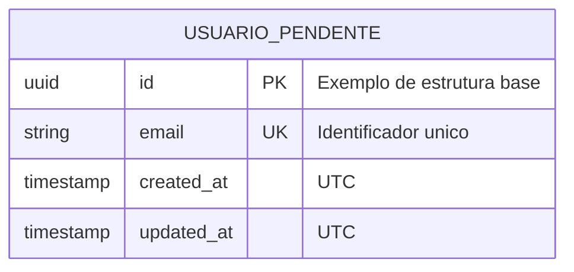

# Banco de Dados e Modelagem — Codit (`TCC-Codit`)

| Campo | Valor |
| :--- | :--- |
| **Projeto** | Codit (`TCC-Codit`) |
| **Status** | Em definição inicial (`Fase 0`) |
| **Última atualização** | `2026-11-22` |
| **Documentos relacionados** | [arquitetura.md](./arquitetura.md) · [regras-negocio.md](./regras-negocio.md) |

---

## 1. Configuração do SGBD e Ferramental

| Item | Definição | Observações |
| :--- | :--- | :--- |
| **SGBD / Engine** | `[Pendente de definição]` | Ex.: PostgreSQL, SQLite, MySQL, etc. |
| **Versão Homologada** | `[Pendente de definição]` | Fixar versão exata para dev, CI e produção |
| **ORM / Query Builder / Driver** | `[Pendente de definição]` | Deve suportar tipagem estrita e migrações versionadas |
| **Ferramenta de Migração** | `[Pendente de definição]` | DDL versionado em repositório |
| **Connection Pooling** | `[Pendente de definição]` | Definir limites mínimo/máximo de conexões e timeouts |
| **Banco de Testes Automatizados** | `[Pendente de definição]` | Isolado por execução (transação/schema/container efêmero) |

---

## 2. Padrões e Convenções de Modelagem

Todas as entidades do Codit devem seguir estas regras estruturais salvo justificativa documentada em ADR:

- **Nomenclatura:** `snake_case` em todos os nomes de tabelas, colunas, constraints e índices.
- **Prefixos de Constraints e Índices:**
  - Chave primária: `pk_<tabela>`
  - Chave estrangeira: `fk_<tabela>_<tabela_referenciada>`
  - Unicidade: `uq_<tabela>_<colunas>`
  - Índice de busca: `idx_<tabela>_<colunas>`
  - Regra de verificação: `chk_<tabela>_<regra>`
- **Estratégia de Chave Primária (PK):** `[Pendente de definição]` (avaliar `UUIDv7` / `ULID` para ordenação temporal e não enumeração em APIs públicas vs `BIGINT` autoincremental interno).
- **Auditoria Temporal:** todas as tabelas de domínio devem incluir:
  - `created_at` (obrigatório, UTC, preenchido na criação)
  - `updated_at` (obrigatório, UTC, atualizado a cada modificação)
  - `deleted_at` (opcional, UTC — usar *soft delete* apenas nas entidades cuja regra de negócio exigir retenção/histórico)
- **Integridade Referencial (`ON DELETE`):**
  - Padrão obrigatório: `ON DELETE RESTRICT` para prevenir exclusões em cascata acidentais.
  - `ON DELETE CASCADE` permitido apenas em tabelas estritamente dependentes (ex.: tabelas associativas N:N ou itens sem existência própria), mediante aprovação explícita.
- **Precisão e Tipagem:**
  - Datas e horários sempre armazenados em **UTC**.
  - Valores monetários ou decimais exatos nunca devem usar ponto flutuante binário (`FLOAT`/`DOUBLE`); usar tipo decimal exato (`NUMERIC`/`DECIMAL`) ou inteiro na menor unidade (centavos).

---

## 3. Diagrama Entidade-Relacionamento (DER)

> **Estado atual:** Esqueleto estrutural aguardando a definição das entidades reais de domínio após o levantamento em [regras-negocio.md](./regras-negocio.md).



---

## 4. Catálogo de Entidades e Dicionário de Dados

### Índice de Entidades

| Entidade / Tabela | Propósito no Domínio | Chave Primária | Relacionamentos Principais | Regras Associadas |
| :--- | :--- | :--- | :--- | :--- |
| `[Pendente de definição]` | `-` | `-` | `-` | `-` |

### Template de Dicionário de Dados (para cada nova tabela)

Replicar a tabela abaixo para cada entidade aprovada:

```markdown
#### Tabela: `<nome_da_tabela>`
- **Propósito:** Descrição objetiva da entidade.
- **Regras relacionadas:** `RN-XXX`
- **Índices e Constraints:** `pk_<tabela>`, `uq_...`, `idx_...`

| Coluna | Tipo | Nulo | Default | Restrições / FK | Descrição |
| :--- | :--- | :--- | :--- | :--- | :--- |
| `id` | `[tipo]` | Não | `[gerador]` | `PK` | Identificador único |
| `created_at` | `TIMESTAMPTZ` | Não | `NOW()` | `-` | Data/hora de criação em UTC |
| `updated_at` | `TIMESTAMPTZ` | Não | `NOW()` | `-` | Data/hora da última atualização em UTC |
```

---

## 5. Índices, Performance e Controle de Concorrência

### Política de Indexação e Consultas
1. **Indexação obrigatória de Foreign Keys:** toda coluna com FK deve possuir índice correspondente (exceto quando já for prefixo esquerdo de uma PK/UQ composta).
2. **Unicidade com Soft Delete:** tabelas com `deleted_at` devem utilizar índice único parcial (`WHERE deleted_at IS NULL`) quando o negócio permitir recriação após exclusão lógica.
3. **Prevenção de Gargalos:** evitar queries N+1 via carregamento explícito/joins planejados; paginar obrigatoriamente todas as consultas de listagem.
4. **Validação de Plano de Execução:** consultas críticas ou relatórios devem ser validados com `EXPLAIN (ANALYZE, BUFFERS)` antes da aprovação.

### Concorrência e Integridade Transacional
- **Transações ACID:** operações que atualizam múltiplas tabelas devem rodar em transação única, mantendo o escopo o mais curto possível (sem chamadas de rede/APIs externas dentro da transação aberta).
- **Prevenção de *Lost Update*:**
  - **Lock Otimista (padrão para edição concorrente):** coluna `version` incrementada atomicamente (`UPDATE ... SET version = version + 1 WHERE id = :id AND version = :expected_version`), retornando conflito HTTP `409` se zero linhas forem afetadas.
  - **Lock Pessimista (recursos críticos/disputados):** `SELECT ... FOR UPDATE` ou nível de isolamento `REPEATABLE READ`/`SERIALIZABLE`, documentando ordem determinística de bloqueio para evitar deadlocks.

---

## 6. Migrações, Rollback e Seeds

- **Proibição de DDL Manual:** toda mudança de schema deve existir como arquivo de migração versionado e revisado.
- **Estratégia Expand-and-Contract (Zero Downtime):**
  1. *Expand:* adicionar colunas/tabelas novas como anuláveis ou com default seguro.
  2. *Backfill & Dual-Write:* migrar dados existentes em lotes e atualizar a aplicação.
  3. *Contract:* somente após o deploy completo, aplicar `NOT NULL` ou remover colunas antigas em migração separada.
- **Rollback:** toda migração deve documentar o procedimento de reversão segura (ou justificativa explícita quando não reversível, exigindo backup prévio).
- **Seeds vs. Fixtures:**
  - *Seeds de produção:* idempotentes (usando `ON CONFLICT DO NOTHING` / `UPSERT`), restritos a dados iniciais obrigatórios (ex.: papéis base do sistema).
  - *Fixtures de desenvolvimento/teste:* determinísticas, sintéticas e isoladas do ambiente de produção.

### Comandos de Migração e Seed
- **Aplicar migrações:** `[Pendente de definição]`
- **Reverter última migração:** `[Pendente de definição]`
- **Executar seeds locais/teste:** `[Pendente de definição]`

---

## 7. Segurança, Privacidade (LGPD) e Backup

### Classificação de Dados

| Classe | Exemplos | Requisitos de Armazenamento e Exposição |
| :--- | :--- | :--- |
| **Público** | Catálogos públicos, metadados abertos | Sem restrição de leitura pública |
| **Interno** | Logs operacionais sem PII, métricas técnicas | Acesso restrito a serviços/equipe |
| **PII / Pessoal (LGPD)** | Nome, e-mail, documentos, IP | Acesso autenticado/autorizado, mascaramento em logs |
| **Credencial / Segredo** | Senhas, hashes de API keys, tokens de sessão | Armazenamento apenas via hash forte (`Argon2id`/`bcrypt` para senhas; `SHA-256`/HMAC para tokens); **nunca** retornar em APIs |

### Proteção, Retenção e Recuperação
- **Transporte e Repouso:** TLS obrigatório na conexão com o SGBD em ambientes compartilhados/produção e criptografia em repouso habilitada no provedor.
- **LGPD:** mapear mecanismo de anonimização ou exclusão definitiva sob solicitação do titular quando aplicável às entidades do Codit.
- **Backup, RPO e RTO:** `[Pendente de definição]` — definir frequência de snapshots automáticos, retenção e periodicidade de testes de restauração (`restore drill`) antes de subir para produção.
