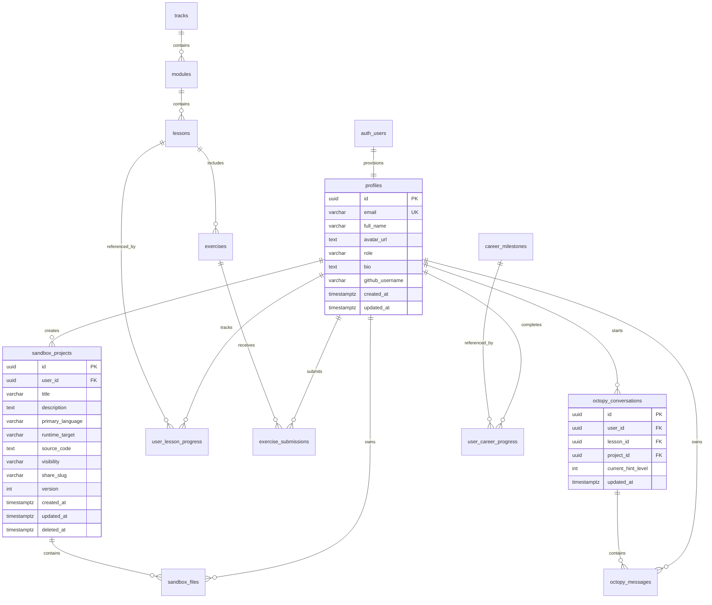

# Banco de Dados e Modelagem — Codit (`TCC-Codit`)

| Campo | Valor |
| :--- | :--- |
| **Projeto** | Codit (`TCC-Codit`) |
| **SGBD Alvo** | PostgreSQL (`16+` gerenciado via **Supabase** — migrações em [20261122000001_init_profiles_and_sandbox_projects.sql](../supabase/migrations/20261122000001_init_profiles_and_sandbox_projects.sql) e [20261123000001_enhance_profiles_and_projects.sql](../supabase/migrations/20261123000001_enhance_profiles_and_projects.sql)) |
| **Última atualização** | `2026-11-23` |
| **Documentos relacionados** | [GEMINI.md](../GEMINI.md) · [arquitetura.md](./arquitetura.md) · [regras-negocio.md](./regras-negocio.md) |

---

## 1. Configuração e Convenções Gerais

| Aspecto | Padrão Definido | Observações |
| :--- | :--- | :--- |
| **Idioma do Schema** | **Inglês (`snake_case`)** | Tabelas no plural, colunas, constraints e índices em inglês |
| **Chaves Primárias (PK)** | `UUID` (preferencial `UUIDv7` ou `gen_random_uuid()`) | Evita enumeração de IDs em URLs/APIs públicas |
| **Timestamps** | `TIMESTAMPTZ` em **UTC** | Toda tabela principal possui `created_at` e `updated_at` (e `deleted_at` onde houver exclusão lógica) |
| **Prefixos de Constraints** | `pk_`, `fk_`, `uq_`, `idx_`, `chk_` | Padronização para leitura clara em logs de erro e migrações |
| **Integridade Referencial** | `ON DELETE RESTRICT` por padrão | Evita exclusões em cascata acidentais; `CASCADE` apenas em vínculos estritamente dependentes (sessões, arquivos de um projeto excluído definitivamente) |
| **ORM / Migrações** | `Supabase SQL Migrations + @supabase/supabase-js` *(Fase 2)* | Migrações SQL versionadas em `supabase/migrations/`; avaliação de ORM complementar (`DEC-001`) para catálogo e backend Fase 3+ |

---

## 2. Regra de Ouro: Isolamento Rigoroso por `user_id`

Toda tabela do **Codit** pertence a exatamente uma de duas categorias:

1. **Catálogo Curricular Público/Compartilhado:** conteúdo pedagógico criado pela plataforma (`tracks`, `modules`, `lessons`, `exercises`, `career_milestones`). Leitura pública/autenticada; escrita restrita ao papel `admin`.
2. **Dados Privados do Usuário (Obrigatório `user_id` / `id` vinculado a `auth.users`):** todos os registros gerados pelo aluno possuem referência obrigatória ao usuário autenticado:
   - `public.profiles` (`id UUID PRIMARY KEY REFERENCES auth.users(id)`)
   - `public.sandbox_projects` (`user_id UUID NOT NULL REFERENCES public.profiles(id)`) e `sandbox_files` *(Fase 3+)*
   - `user_lesson_progress` e `exercise_submissions` *(Fase 3+)*
   - `octopy_conversations` e `octopy_messages` *(Fase 4)*
   - `user_career_progress` *(Fase 3+)*

### Defesa em Profundidade (Aplicação + PostgreSQL RLS no Supabase)
- **Camada de Aplicação (`src/modules/`):** toda consulta e mutação em `profiles` e `sandbox_projects` filtra explicitamente pelo `userId` da sessão autenticada (`eq("id", userId)` / `eq("user_id", userId)`).
- **PostgreSQL Row-Level Security (RLS ativa na Fase 2):** `public.profiles` e `public.sandbox_projects` operam com RLS habilitada usando `auth.uid()` diretamente no banco, protegendo as operações realizadas via cliente client-side (`NEXT_PUBLIC_SUPABASE_ANON_KEY`) em Web/PWA, Tauri `.exe` e Capacitor `.apk`.
- **Exceção controlada para Portfólio:** um mini-projeto em `sandbox_projects` com `visibility = 'public_portfolio'` e `deleted_at IS NULL` possui policy `SELECT` pública somente leitura (`sandbox_projects_select_public_portfolio`), mantendo criação, edição e exclusão restritas ao dono (`auth.uid() = user_id`).
- **Atenção em Soft Delete com RLS:** a policy `sandbox_projects_select_own` para o dono não inclui `AND deleted_at IS NULL` para evitar erro de permissão quando o cliente executa `.update({ deleted_at }).select()` ao excluir logicamente; o filtro `deleted_at IS NULL` é aplicado nas queries ativas em `src/modules/sandbox/sandbox-project-service.ts`.

---

## 3. Diagrama Entidade-Relacionamento (DER)

---

## 4. Dicionário de Dados Planejado

### 4.1 Identidade e Autenticação (Implementado via Supabase — Fase 2)

> **Autenticação delegada ao Supabase Auth (`auth.users`):** credenciais de e-mail/senha, verificação de e-mail, fluxos Google OAuth 2.0 (PKCE) e tokens de sessão são gerenciados pelo esquema interno `auth` do Supabase. O esquema público (`public`) mantém a tabela `public.profiles` sincronizada 1:1 com `auth.users`.

#### `public.profiles` *(Implementada na migração `20261122000001` e expandida na `20261123000001`)*
- **Propósito:** Perfil do estudante/administrador espelhado 1:1 com `auth.users(id)`, com personalização visual e dados de portfólio.
- **Regras associadas:** `RN-001`, `RN-002`, `RN-003`
- **Triggers:**
  - `on_auth_user_created` (`AFTER INSERT ON auth.users` via `public.handle_new_user()` `SECURITY DEFINER`): cria automaticamente o perfil com `role = 'student'`, extraindo `full_name` e `avatar_url` dos metadados OAuth/cadastro (`ON CONFLICT (id) DO NOTHING`).
  - `trg_profiles_prevent_role_escalation` (`BEFORE UPDATE` via `public.prevent_profile_role_escalation()`): bloqueia alteração do campo `role` por clientes comuns (`auth.role() <> 'service_role'`).
  - `trg_profiles_set_updated_at` (`BEFORE UPDATE`): atualiza `updated_at = NOW()`.
- **Políticas RLS:** `profiles_select_own` (`auth.uid() = id`), `profiles_insert_own` (`auth.uid() = id AND role = 'student'`) e `profiles_update_own` (`auth.uid() = id`).

| Coluna | Tipo | Nulo | Default / Restrição | Descrição |
| :--- | :--- | :--- | :--- | :--- |
| `id` | `UUID` | Não | `PK`, `FK -> auth.users(id) ON DELETE CASCADE` | Identificador único do usuário (`user_id` global) |
| `email` | `VARCHAR(255)` | Não | `uq_profiles_email_lower` (case-insensitive) | E-mail normalizado em minúsculas |
| `full_name` | `VARCHAR(120)` | Não | `''` | Nome de exibição do usuário |
| `avatar_url` | `TEXT` | Sim | `-` | URL sanitizada (`http`/`https`) ou avatar oficial `/icons/octopy-*.png` |
| `role` | `VARCHAR(20)` | Não | `'student'` (`chk_profiles_role`: `'student'`, `'admin'`) | Papel RBAC do aluno ou equipe |
| `bio` | `TEXT` | Sim | `chk_profiles_bio_length` (máx. 500 chars) | Resumo/objetivo de carreira do aluno |
| `github_username` | `VARCHAR(60)` | Sim | `chk_profiles_github_format` | Identificador público no GitHub (sem `@`) |
| `headline` | `VARCHAR(120)` | Sim | `-` | Título ou foco profissional do perfil |
| `location` | `VARCHAR(80)` | Sim | `-` | Cidade/país exibido no perfil |
| `website_url` | `TEXT` | Sim | `chk_profiles_website_url` (`https?://`) | Link do site ou portfólio pessoal |
| `linkedin_url` | `TEXT` | Sim | `chk_profiles_linkedin_url` (`https?://`) | Link do perfil no LinkedIn |
| `banner_preset` | `VARCHAR(40)` | Não | `'nebula'` (`chk_profiles_banner_preset`) | Capa visual selecionada no perfil |
| `accent_theme` | `VARCHAR(30)` | Não | `'violet'` (`chk_profiles_accent_theme`) | Tema de cor de destaque do perfil |
| `avatar_frame` | `VARCHAR(30)` | Não | `'glow'` (`chk_profiles_avatar_frame`) | Estilo de moldura do avatar |
| `octopy_companion` | `VARCHAR(20)` | Não | `'coding'` (`chk_profiles_octopy_companion`) | Humor/variante do mascote Octopy no perfil |
| `skills` | `TEXT[]` | Não | `'{}'` (`chk_profiles_skills_limit`, máx. 12) | Lista de habilidades e tecnologias |
| `show_email` | `BOOLEAN` | Não | `FALSE` | Define se o e-mail aparece no cartão de perfil |
| `created_at` | `TIMESTAMPTZ` | Não | `NOW()` | Criação em UTC |
| `updated_at` | `TIMESTAMPTZ` | Não | `NOW()` | Última atualização em UTC |

---

### 4.2 Catálogo Educacional (Conteúdo em `pt-BR`) e Progresso

#### `tracks`, `modules`, `lessons`, `exercises` (Catálogo Compartilhado)

| Tabela | Colunas Chave | Propósito |
| :--- | :--- | :--- |
| `tracks` | `id`, `slug` (`UQ`), `title`, `category` (`programming`, `ai`, `git_github`, `best_practices`, `career`), `level` (`beginner`, `intermediate`, `advanced`), `order_index`, `is_published` | Trilhas principais do Codit |
| `modules` | `id`, `track_id` (`FK -> tracks`), `slug`, `title`, `order_index` | Agrupamento temático dentro de uma trilha |
| `lessons` | `id`, `module_id` (`FK -> modules`), `slug`, `title`, `content_markdown`, `estimated_minutes`, `order_index` | Conteúdo didático em `pt-BR` |
| `exercises` | `id`, `lesson_id` (`FK -> lessons`), `title`, `prompt_markdown`, `language`, `starter_code_json`, `validation_rules_json`, `static_hints_json`, `order_index` | Desafios práticos com dicas estáticas de contingência para o Octopy |

#### `user_lesson_progress` (Privado — `user_id`)
- **Chave Única:** `uq_progress_user_lesson (user_id, lesson_id)`
- **Colunas:** `id` (`PK`), `user_id` (`FK -> users`, `NOT NULL`), `lesson_id` (`FK -> lessons`, `NOT NULL`), `status` (`not_started`, `in_progress`, `completed`), `progress_percent` (`SMALLINT` 0..100), `completed_at` (`TIMESTAMPTZ`), `version` (`INTEGER DEFAULT 1`), `updated_at` (`TIMESTAMPTZ`).

#### `exercise_submissions` (Privado — `user_id`)
- **Propósito:** Histórico de tentativas do aluno nos exercícios sem expor código de outros alunos.
- **Colunas:** `id` (`PK`), `user_id` (`FK -> users`, `NOT NULL`), `exercise_id` (`FK -> exercises`, `NOT NULL`), `code_snapshot_json` (`JSONB`), `runtime_target` (`VARCHAR(30)`), `passed` (`BOOLEAN`), `feedback_summary` (`TEXT`), `created_at` (`TIMESTAMPTZ`).

---

### 4.3 Sandbox e Mini-Projetos

#### `public.sandbox_projects` *(Implementada na migração `20261122000001` e expandida na `20261123000001` — Privado por padrão)*
- **Regras associadas:** `RN-201` a `RN-205`
- **Políticas RLS:** `sandbox_projects_select_own`, `sandbox_projects_select_public_portfolio`, `sandbox_projects_insert_own`, `sandbox_projects_update_own`, `sandbox_projects_delete_own`.

| Coluna | Tipo | Nulo | Restrição / Valores | Descrição |
| :--- | :--- | :--- | :--- | :--- |
| `id` | `UUID` | Não | `PK`, `DEFAULT gen_random_uuid()` | Identificador do mini-projeto |
| `user_id` | `UUID` | Não | `fk_sandbox_projects_user_id -> public.profiles(id) ON DELETE CASCADE` | Dono exclusivo para edição/exclusão |
| `title` | `VARCHAR(120)` | Não | `chk_sandbox_projects_title` (não vazio) | Título do mini-projeto |
| `description` | `TEXT` | Sim | `chk_sandbox_projects_description` (máx. 500 chars) | Descrição curta para portfólio |
| `primary_language` | `VARCHAR(30)` | Não | `'html_css_js'`, `'html'`, `'css'`, `'javascript'`, `'typescript'`, `'python'`, `'react'`, `'nodejs'`, `'java'`, `'csharp'`, `'cpp'`, `'go'`, `'rust'`, `'sql'`, `'php'` | Linguagem / stack principal (com ícone associado na UI) |
| `runtime_target` | `VARCHAR(30)` | Não | `'client_iframe'`, `'client_pyodide'`, `'remote_judge0'`, `'remote_piston'` | Motor de execução associado |
| `source_code` | `TEXT` | Não | `''` (`chk_sandbox_projects_source_size`, máx. 200.000 chars) | Código-fonte principal do mini-projeto no MVP |
| `visibility` | `VARCHAR(20)` | Não | `'private'` (`'private'`, `'unlisted'`, `'public_portfolio'`) | Visibilidade padrão estritamente privada |
| `share_slug` | `VARCHAR(80)` | Sim | `uq_sandbox_projects_share_slug` (parcial `WHERE share_slug IS NOT NULL AND deleted_at IS NULL`) | Slug público somente leitura para portfólio |
| `is_pinned` | `BOOLEAN` | Não | `FALSE` | Destaca o projeto no topo da lista |
| `tags` | `TEXT[]` | Não | `'{}'` (`chk_sandbox_projects_tags_limit`, máx. 6) | Etiquetas de organização/tema |
| `repository_url` | `TEXT` | Sim | `chk_sandbox_projects_repo_url` (`https?://`) | Link opcional para repositório externo (GitHub) |
| `live_url` | `TEXT` | Sim | `chk_sandbox_projects_live_url` (`https?://`) | Link opcional para demonstração publicada |
| `version` | `INTEGER` | Não | `1` (`chk_sandbox_projects_version >= 1`) | Lock otimista anti-sobrescrita multi-aba (`RN-203`) |
| `created_at` / `updated_at` / `deleted_at` | `TIMESTAMPTZ` | `created`/`updated` Não | `trg_sandbox_projects_set_updated_at` | Auditoria temporal e soft delete |

#### `sandbox_files` (Privado — `user_id`)
- **Colunas:** `id` (`PK`), `project_id` (`FK -> sandbox_projects`, `ON DELETE CASCADE`), `user_id` (`FK -> users`, `NOT NULL` — garante RLS direta sem join), `file_path` (`VARCHAR(160)`), `language` (`VARCHAR(20)`), `content` (`TEXT`), `is_entry_point` (`BOOLEAN DEFAULT FALSE`), `updated_at` (`TIMESTAMPTZ`).
- **Unicidade:** `uq_sandbox_files_project_path (project_id, file_path)`.

---

### 4.4 Tutor IA (`Octopy`) e Carreira Tech

#### `octopy_conversations` e `octopy_messages` (Privados — `user_id`)
- `octopy_conversations`: `id` (`PK`), `user_id` (`FK -> users`, `NOT NULL`), `lesson_id` (`FK -> lessons`, `NULL`), `project_id` (`FK -> sandbox_projects`, `NULL`), `title` (`VARCHAR(140)`), `current_hint_level` (`SMALLINT DEFAULT 1`), `created_at`, `updated_at`.
- `octopy_messages`: `id` (`PK`), `conversation_id` (`FK -> octopy_conversations`, `ON DELETE CASCADE`), `user_id` (`FK -> users`, `NOT NULL`), `sender` (`student`, `octopy`, `system_fallback`), `content` (`TEXT`), `hint_level` (`SMALLINT`), `provider_model` (`VARCHAR(60)`), `token_usage` (`INTEGER`), `created_at`.

#### `career_milestones` e `user_career_progress`
- `career_milestones`: `id` (`PK`), `slug` (`UQ`), `category` (`portfolio`, `github`, `resume`, `interview`), `title`, `checklist_markdown`, `order_index`.
- `user_career_progress`: `id` (`PK`), `user_id` (`FK -> users`, `NOT NULL`), `milestone_id` (`FK -> career_milestones`, `NOT NULL`), `status` (`pending`, `in_progress`, `completed`), `artifact_url` (`TEXT`), `notes` (`TEXT`), `updated_at`.
- **Unicidade:** `uq_career_user_milestone (user_id, milestone_id)`.

---

## 5. Índices Críticos, Concorrência, Migrações e LGPD

### Índices Obrigatórios
- `idx_user_sessions_user_active` em `user_sessions (user_id, expires_at) WHERE revoked_at IS NULL`
- `idx_progress_user_status` em `user_lesson_progress (user_id, status)`
- `idx_submissions_user_exercise_date` em `exercise_submissions (user_id, exercise_id, created_at DESC)`
- `idx_projects_user_updated` em `sandbox_projects (user_id, updated_at DESC) WHERE deleted_at IS NULL`
- `idx_octopy_conv_user_updated` em `octopy_conversations (user_id, updated_at DESC)`
- Toda chave estrangeira deve possuir índice correspondente.

### Controle de Concorrência
- **Lock Otimista (`version`):** obrigatório em `sandbox_projects` e `user_lesson_progress` para evitar perda de código quando o aluno alterna entre celular (PWA) e desktop.
- **Transações ACID:** atualizações compostas (ex.: criar conta + vincular OAuth; salvar projeto + arquivos; registrar submissão aprovada + marcar lição concluída) executam em transação única sem chamadas externas de IA/rede dentro da transação aberta.

### Migrações e LGPD
- **Migrações:** proibição de DDL manual em produção; mudanças destrutivas seguem estratégia *Expand-and-Contract* em etapas separadas.
- **LGPD:**
  - Senhas apenas com hash `Argon2id`/`bcrypt`; tokens de sessão com `SHA-256`.
  - Conexões PostgreSQL em produção exigem TLS (`sslmode=require`).
  - Direito de exclusão: ao excluir conta, revogar sessões imediatamente, remover/anonimizar PII em `users`, excluir registros privados vinculados ao `user_id` e revogar visibilidade pública de portfólios associados.
