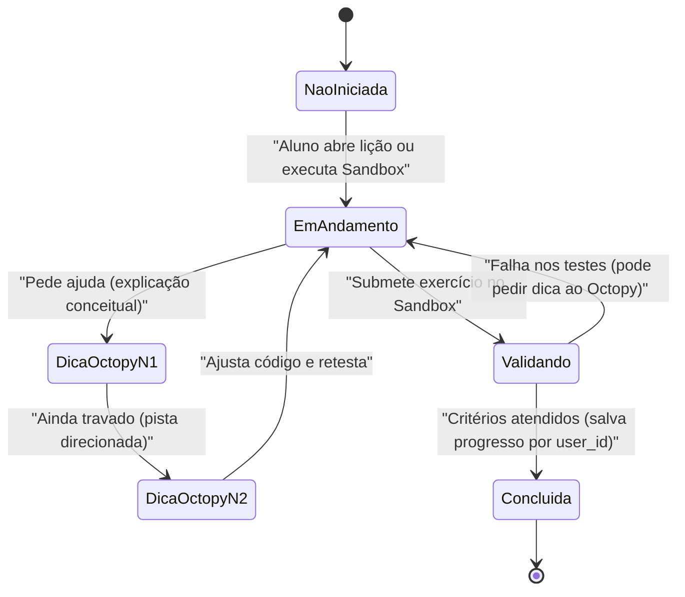

# Regras de Negócio e Domínio — Codit (`TCC-Codit`)

| Campo | Valor |
| :--- | :--- |
| **Projeto** | Codit (`TCC-Codit`) |
| **Status** | Especificação viva (Fases 0–2 + Rede Social Comunidade Codit + Mensagens & Voz) |
| **Última atualização** | `2026-11-24` |
| **Documentos relacionados** | [GEMINI.md](../GEMINI.md) · [arquitetura.md](./arquitetura.md) · [banco-de-dados.md](./banco-de-dados.md) |

---

## 1. Propósito e Rastreabilidade

Este documento define as regras funcionais, invariantes e casos de borda do **Codit**. Toda regra possui um código único e imutável `RN-XXX` que deve ser referenciado no código de domínio e nos testes automatizados quando a implementação iniciar.

---

## 2. Glossário de Domínio (Linguagem Ubíqua)

| Termo | Definição no Domínio Codit | Idioma de Uso |
| :--- | :--- | :--- |
| **Codit** | Plataforma SaaS educacional Web Mobile-First + PWA para ensino de tecnologia e carreira | UI/Docs |
| **Octopy** | Mascote (polvo roxo) e tutor interativo com IA de pedagogia socrática | UI/Código (`octopy`) |
| **Track (Trilha)** | Jornada macro de aprendizagem (ex.: Programação Base, IA, Git/GitHub, Carreira Tech) | Código (`tracks`) / UI (`Trilhas`) |
| **Module (Módulo)** | Subdivisão temática dentro de uma trilha | Código (`modules`) / UI (`Módulos`) |
| **Lesson (Lição)** | Unidade didática em `pt-BR` com explicação teórica e prática guiada | Código (`lessons`) / UI (`Lições`) |
| **Exercise (Exercício)** | Desafio prático validado no Sandbox ou por critérios de teste | Código (`exercises`) / UI (`Exercícios`) |
| **Sandbox** | Ambiente isolado para executar código (client-side no MVP; remoto na Fase 2+) | Código (`sandbox`) / UI (`Sandbox`) |
| **Mini-Projeto** | Projeto de prática criado e salvo pelo aluno em sua área privada ou portfólio | Código (`sandbox_projects`) |

---

## 3. Perfis de Acesso e Matriz RBAC

| Recurso / Ação | `guest` (Visitante) | `student` (Aluno) | `admin` (Curadoria/Equipe) |
| :--- | :---: | :---: | :---: |
| Navegar em trilhas/lições abertas (leitura) | Sim (limitado) | Sim | Sim |
| Experimentar Sandbox sem persistência em nuvem | Opcional | Sim | Sim |
| Salvar progresso, submissões e mini-projetos (`user_id`) | Não | Somente próprios | Próprios + moderação |
| Conversar com o tutor **Octopy** | Não | Sim (com cota) | Sim |
| Visualizar mini-projeto `public_portfolio` / `unlisted` | Somente leitura | Somente leitura | Somente leitura |
| Criar/editar currículo (`tracks`, `lessons`, `exercises`) | Não | Não | Sim |

> Toda autorização deve ser validada no servidor; controles visuais no frontend servem apenas para UX.

---

## 4. Catálogo de Regras de Negócio (`RN-XXX`)

### Módulo A — Autenticação, Segurança e Isolamento (`RN-001` a `RN-004`)

- **`RN-001` — Autenticação Dupla (Tradicional + Google OAuth 2.0):**
  - O usuário pode cadastrar-se e autenticar com e-mail/senha ou via Google OAuth 2.0 (OIDC com `state` e PKCE).
  - Contas locais criadas por e-mail/senha exigem confirmação do endereço de e-mail (suportando retorno via `?token_hash=...&type=signup` via `verifyOtp` para compatibilidade entre navegadores/dispositivos ou callback PKCE), com opção segura de reenvio protegida por intervalo mínimo (`60s`) e limite de tentativas (`3` em `15` minutos), além de detecção de e-mail já vinculado para evitar falso positivo no cadastro.
  - Contas Google-only iniciam com `password_hash = NULL` e podem definir senha local posteriormente mediante confirmação autenticada.
- **`RN-002` — Vinculação Segura de Contas por E-mail:**
  - Uma conta Google só pode ser vinculada automaticamente a uma conta local existente com o mesmo e-mail quando **ambas** possuírem e-mail verificado (`email_verified === true`). Caso contrário, exige autenticação prévia na conta existente antes de vincular, evitando sequestro de conta (*account takeover*).
- **`RN-003` — Isolamento Estrito por `user_id` (Anti-IDOR):**
  - Progresso de lições, submissões, mini-projetos, conversas do Octopy e metas de carreira pertencem estritamente ao `user_id` dono do registro.
  - Tentativas de leitura/alteração/exclusão usando UUID de outro usuário devem ser bloqueadas no servidor com HTTP `403` ou `404` (sem vazar dados privados).
- **`RN-004` — Proteção Absoluta de Segredos:**
  - Nenhuma chave de API (LLM do Octopy, Google OAuth Secret, `DATABASE_URL`, Judge0/Piston) pode ser exposta no bundle client-side ou no repositório Git.

### Módulo B — Aprendizagem, Currículo e Experiência PWA (`RN-101` a `RN-104`)

- **`RN-101` — Idioma Didático e Técnico:**
  - Todo conteúdo educacional, interface, mensagens de feedback e falas do Octopy são apresentados em **Português (`pt-BR`)**, enquanto código-fonte do projeto, rotas `/api/v1/*` e schema SQL seguem padrão em **inglês**.
- **`RN-102` — Progresso Idempotente e Monotônico por Usuário:**
  - O progresso do aluno em uma lição é registrado por `(user_id, lesson_id)`. Reenvios repetidos de conclusão não duplicam registros nem regridem uma lição já marcada como `completed` (salvo reset explícito solicitado pelo aluno).
- **`RN-103` — Trilhas de Carreira e Portfólio:**
  - Além de programação, IA e Git/GitHub, o sistema mantém checklist prático de carreira (`career_milestones`) onde o aluno acompanha progresso de currículo, GitHub, portfólio e preparação para entrevistas de forma isolada pelo seu `user_id`.
- **`RN-104` — Experiência Mobile-First e PWA:**
  - Todas as telas principais (dashboard, leitor de lição, sandbox, mini-projetos e chat do Octopy) devem ser utilizáveis a partir de `360px` de largura e instaláveis como PWA. Ações dependentes de rede devem informar o usuário claramente quando offline.

### Módulo C — Sandbox e Mini-Projetos (`RN-201` a `RN-205`)

- **`RN-201` — Execução Isolada no Cliente (MVP):**
  - No MVP, o Sandbox suporta **HTML, CSS, JavaScript** (via `<iframe sandbox="allow-scripts">` sem `allow-same-origin`) e **Python** (via Pyodide WASM em Web Worker dedicado).
  - É proibido enviar código de usuário para execução no processo principal do servidor Next.js/Node.
- **`RN-202` — Limites de Execução e Proteção contra Travamento:**
  - Execuções possuem timeout configurável (ex.: `3s`–`5s` por execução), truncamento seguro de saída excessiva (`stdout`/`console`) e encerramento forçado (`worker.terminate()` / recriação do iframe) em caso de loop infinito.
- **`RN-203` — Persistência de Mini-Projetos com Concorrência Otimista:**
  - Alunos autenticados podem criar, editar e excluir mini-projetos vinculados ao seu `user_id`, respeitando limites de tamanho por arquivo/projeto e controle de versão (`version`) para impedir sobrescrita silenciosa entre abas ou dispositivos.
- **`RN-204` — Privacidade Padrão e Portfólio Compartilhável:**
  - Todo mini-projeto nasce como `private`. O aluno pode optar explicitamente por `unlisted` ou `public_portfolio` para compartilhar no portfólio (exposição pública apenas em modo **somente leitura** e executada exclusivamente no navegador do visitante).
- **`RN-205` — Expansão Multi-Linguagem via Provedor Remoto (Fase 2+):**
  - Novas linguagens fora do suporte client-side (ex.: Java, C++, Go, Rust) usarão exclusivamente a interface `CodeExecutionProvider` no backend apontando para ambiente isolado (Judge0 CE / Piston).

### Módulo D — Tutor IA Octopy (`RN-301` a `RN-305`)

- **`RN-301` — Pedagogia Socrática Progressiva:**
  - O **Octopy** atua como guia didático: diante de uma dúvida ou erro no exercício, prioriza explicar o conceito, apontar a região do problema e fazer perguntas orientadoras (`hint_level` 1 → 2 → 3), evitando entregar a solução completa pronta logo na primeira interação.
- **`RN-302` — Proxy Server-Side e Proteção contra Prompt Injection:**
  - Toda chamada ao modelo de IA passa pelo backend (`/api/v1/octopy/chat`), que injeta o `system prompt` do Octopy, contextualiza lição/código do aluno em blocos delimitados e impede alteração das instruções de sistema pelo cliente.
- **`RN-303` — Quotas e Rate Limit por `user_id`:**
  - Cada aluno possui limite de requisições por janela de tempo e cota diária. Ao atingir o limite, a API retorna HTTP `429` em `pt-BR` indicando o tempo de espera sem falhar de forma opaca.
- **`RN-304` — Contingência de Disponibilidade da IA:**
  - Em caso de indisponibilidade, timeout ou esgotamento de cota do provedor LLM, o sistema aciona fallback de modelo/provedor ou entrega dicas estáticas pré-curadas da lição (`static_hints_json`).
- **`RN-305` — Privacidade do Histórico com o Octopy:**
  - Conversas (`octopy_conversations` e `octopy_messages`) são estritamente privadas por `user_id` e jamais são compartilhadas entre alunos.

### Módulo E — Comunidade Codit, Perfis `@`, Amizades e Projetos Compartilhados (`RN-401` a `RN-405`)

- **`RN-401` — Identificador Público `@username` Sem Exposição de PII e Intervalo de Alteração:**
  - Todo perfil possui um `username` único normalizado em minúsculas (`[a-z0-9._]`, 3–30 caracteres, sem termos reservados nem combinações de impersonação como `codit_oficial` ou `octopy_admin`).
  - A primeira definição personalizada de `@username` (`username_changed_at IS NULL`) é liberada imediatamente; alterações subsequentes exigem intervalo mínimo de **30 dias**, validado no frontend e no servidor/banco via trigger `normalize_profile_username()` (protegido contra adulteração de `username_changed_at`), exibindo ao usuário a próxima data liberada. Salvar outros dados do perfil sem mudar o `@` não aciona o cooldown.
  - Buscas por `@usuário` ou nome consultam exclusivamente `public.public_profiles`, sem jamais expor `email`, `role` ou `username_changed_at` de `public.profiles`.
- **`RN-402` — Amizade Bilateral com Integridade de Par Único:**
  - Solicitações de amizade exigem `requester_id = auth.uid()`, impedem auto-amizade e garantem unicidade simétrica por par `(LEAST, GREATEST)`.
  - Apenas o destinatário (`addressee_id`) pode aceitar um pedido `pending`, e apenas os participantes podem cancelar ou desfazer a amizade.
- **`RN-403` — Controle de Visibilidade de Projetos (`private`, `friends`, `unlisted`, `public_portfolio`):**
  - Projetos `private` permanecem acessíveis apenas ao dono; projetos `friends` ficam visíveis apenas para amigos aceitos; projetos `public_portfolio` são visíveis no feed público da Comunidade.
- **`RN-404` — Execução Isolada na Visualização Social:**
  - A prévia de mini-projetos HTML/CSS/JS de terceiros roda em `<iframe sandbox="allow-scripts">` sem `allow-same-origin` e com política CSP restritiva (`RN-201`).
- **`RN-405` — Interações Sociais e Clonagem Privada:**
  - Curtidas (`project_likes`) e comentários (`project_comments`, 1–500 caracteres) exigem acesso legítimo ao projeto (`can_view_sandbox_project`).
  - Clonar um projeto de outro usuário cria uma cópia estritamente `private` vinculada ao `user_id` do usuário autenticado.

### Módulo F — Mensagens Embutidas, Grupos, Voz e Compartilhamento de Tela (`RN-501` a `RN-505`)

- **`RN-501` — Mensagens Diretas e Convites Exclusivos para Amigos:**
  - Conversas diretas (`kind = 'direct'`) só podem ser iniciadas, enviadas ou usadas em chamadas de voz quando existe vínculo `'accepted'` ativo entre os dois usuários em `public.friendships` (`are_users_friends` e `can_send_chat_message`).
  - Se a amizade for desfeita após a criação da conversa, o histórico permanece legível aos participantes, porém o envio de novas mensagens e chamadas de voz é bloqueado no banco (RLS) e na interface, e chamadas ativas na DM são encerradas automaticamente.
  - Criação de grupos e adição de novos membros só permitem convidar usuários que sejam amigos aceitos do autor da ação.
- **`RN-502` — Limite Máximo de 10 Pessoas por Grupo:**
  - Todo grupo (`kind = 'group'`) exige pelo menos 2 participantes na criação (criador + 1..9 amigos) e impõe teto estrito de **10 membros ativos** (`left_at IS NULL`) validado no Zod (`createGroupConversationSchema`, `validateGroupMemberAddition`), na UI, nas RPCs `create_group_conversation` / `add_group_conversation_members` e no trigger com lock `FOR UPDATE` (`enforce_chat_member_limits`).
- **`RN-503` — Isolamento de Conversas e Zero Acesso Anônimo:**
  - Tabelas `chat_conversations`, `chat_conversation_members` e `chat_messages` negam qualquer privilégio a `anon` e permitem leitura/envio apenas a participantes ativos autenticados (`is_active_chat_member`), além de descartar sinais WebRTC de usuários fora da conversa.
- **`RN-504` — Chamadas Exclusivamente de Voz (Proibido Vídeo de Câmera):**
  - Chamadas capturam apenas áudio (`getUserMedia({ audio: ..., video: false })`); a permissão `camera=()` permanece bloqueada em `Permissions-Policy`, `android.permission.CAMERA` não é declarada no Android e faixas de vídeo recebidas/enviadas que não sejam compartilhamento de tela autorizado são descartadas.
- **`RN-505` — Compartilhamento de Tela em Chamadas de Voz:**
  - Participantes em dispositivos compatíveis com `getDisplayMedia` podem compartilhar tela/janela (`audio: false`), enquanto todos os participantes ativos na chamada (inclusive em dispositivos móveis sem `getDisplayMedia`) podem visualizar a transmissão ao vivo e alternar entre múltiplas telas compartilhadas.

---

## 5. Fluxos Críticos e Máquinas de Estado

### Ciclo de Aprendizagem e Apoio Socrático do Octopy

---

## 6. Casos de Borda Obrigatórios para Testes Futuros

| Cenário | Comportamento Esperado | Regra |
| :--- | :--- | :--- |
| **Loop infinito no Python/JS** | Watchdog interrompe o Web Worker (`terminate`) / iframe após o timeout sem travar a UI principal | `RN-202` |
| **Tentativa de XSS via HTML/JS no Sandbox** | Script roda em `iframe` sem `allow-same-origin` (origem `null`); não acessa cookies, `DOM` do Codit nem tokens | `RN-201` |
| **Troca de `projectId` na URL/API (IDOR)** | Usuário B tentando ler/editar mini-projeto privado do Usuário A recebe HTTP `403`/`404` | `RN-003` |
| **Edição simultânea em celular + desktop** | Segunda gravação com `version` desatualizado recebe HTTP `409 Conflict` e alerta o usuário sem sobrescrever | `RN-203` |
| **Colisão de e-mail entre login local e Google OAuth** | Se conta local não tiver e-mail verificado, bloqueia auto-vinculação e exige confirmação autenticada | `RN-002` |
| **Timeout ou cota excedida na API de IA** | Retorna fallback/dica estática da lição ou mensagem amigável HTTP `429`/`503` em `pt-BR` | `RN-303`, `RN-304` |
| **PWA sem conexão à internet** | Permite leitura de shell/cache estático e exibe aviso claro ao tentar login, Octopy ou salvar na nuvem | `RN-104` |

---

## 7. Histórico de Alterações

| Data | Escopo | Resumo |
| :--- | :--- | :--- |
| `2026-11-22` | Inicial | Formalização completa de glossário, RBAC, regras `RN-001` a `RN-305`, estados e casos de borda do SaaS Codit |
| `2026-11-23` | Módulo E | Inclusão das regras `RN-401` a `RN-405` da rede social embutida (**Comunidade Codit**): `@username`, `public_profiles`, amizades, visibilidade `friends` e clonagem segura |
| `2026-11-24` | Módulo F | Inclusão das regras `RN-501` a `RN-505` do sistema de mensagens embutido: DMs restritas a amigos, grupos até 10 pessoas, chamadas de voz sem câmera e compartilhamento de tela |
