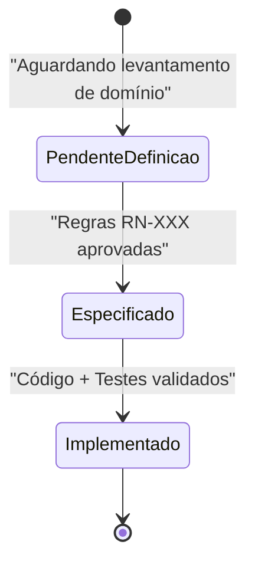

# Regras de Negócio e Especificação de Domínio — Codit (`TCC-Codit`)

| Campo | Valor |
| :--- | :--- |
| **Projeto** | Codit (`TCC-Codit`) |
| **Status** | Em definição inicial (`Fase 0`) |
| **Última atualização** | `2026-11-22` |
| **Documentos relacionados** | [GEMINI.md](../GEMINI.md) · [arquitetura.md](./arquitetura.md) · [banco-de-dados.md](./banco-de-dados.md) |

---

## 1. Propósito e Política de Rastreabilidade

Este documento é a referência canônica para todo comportamento de domínio do **Codit**.

- **Identificador Único:** toda regra de negócio recebe um código sequencial e imutável no formato `RN-XXX`.
- **Rastreabilidade Bidirecional Obrigatória:**
  - `regras-negocio.md` (`RN-XXX`) ↔ código de domínio/validação (`src/`) ↔ testes automatizados (`tests/`).
  - Nenhuma regra de negócio deve existir apenas no frontend; toda invariante crítica deve ser garantida pelo backend e persistência.

---

## 2. Glossário de Domínio (Linguagem Ubíqua)

Use exclusivamente os termos oficiais abaixo em código, APIs, banco de dados, telas e documentação:

| Termo Oficial | Definição no Domínio Codit | Termos a Evitar | Módulo / Entidade |
| :--- | :--- | :--- | :--- |
| `[Pendente de definição]` | `-` | `-` | `-` |

---

## 3. Perfis de Acesso e Matriz de Permissões (RBAC)

### Perfis Previstos

| Perfil / Papel | Descrição | Escopo de Dados | Estado |
| :--- | :--- | :--- | :--- |
| `[Pendente de definição]` | `-` | `-` | `Pendente` |

### Matriz de Permissões por Recurso

| Recurso / Operação | Perfil A (`[Pendente]`) | Perfil B (`[Pendente]`) | Observações / Regras |
| :--- | :--- | :--- | :--- |
| `[Pendente de definição]` | `-` | `-` | Princípio do menor privilégio; validação server-side obrigatória |

---

## 4. Catálogo de Regras de Negócio (`RN-XXX`)

### Convenção de Faixas por Domínio

| Faixa | Domínio / Módulo |
| :--- | :--- |
| `RN-001` a `RN-099` | Autenticação, Sessão, Usuários e Autorização (RBAC) |
| `RN-100` a `RN-199` | Fluxo Principal do Domínio Codit `[Pendente de definição]` |
| `RN-200` a `RN-299` | Fluxos Secundários, Relatórios e Auditoria `[Pendente de definição]` |
| `RN-300` a `RN-399` | Integrações Externas, Notificações, Limites e Contingência |

### Índice de Regras Registradas

| ID | Título | Módulo | Prioridade | Status | Testes Vinculados |
| :--- | :--- | :--- | :--- | :--- | :--- |
| `[Pendente de definição]` | `-` | `-` | `-` | `-` | `-` |

### Template Padrão de Especificação (`RN-XXX`)

Toda nova regra adicionada deve seguir integralmente esta ficha:

```markdown
### RN-XXX — Título Objetivo da Regra
- **Módulo:** Nome do módulo
- **Status:** Rascunho | Aprovada | Implementada | Obsoleta
- **Descrição:** O que a regra determina de forma clara e sem ambiguidade.
- **Pré-condições:** Estado ou permissões exigidas antes da execução.
- **Invariantes e Validações:** Condições que nunca podem ser violadas.
- **Resposta de Erro:** Status HTTP (`400`/`403`/`404`/`409`/`422`) e código de erro de domínio.
- **Casos de Borda:** Concorrência, limites, entradas nulas/vazias, fuso horário, retry.
- **Critérios de Aceite (BDD):**
  - **Dado** `<contexto inicial>`
  - **Quando** `<ação executada>`
  - **Então** `<resultado esperado no estado e na resposta>`
```

---

## 5. Fluxos Críticos e Máquinas de Estado

> **Estado atual:** Diagrama estrutural aguardando a definição dos fluxos reais e estados de entidades do Codit.



---

## 6. Regras Transversais e Casos de Borda Obrigatórios

Independentemente do domínio específico do Codit, estas regras transversais aplicam-se a todo o sistema:

- [ ] **Idempotência:** operações críticas mutáveis não devem gerar duplicidades em caso de reenvio por falha de rede ou duplo clique.
- [ ] **Concorrência:** atualizações simultâneas no mesmo registro não devem causar perda silenciosa de dados (*lost update*); aplicar controle otimista/pessimista conforme [banco-de-dados.md](./banco-de-dados.md).
- [ ] **Datas, Fuso Horário e Precisão:** comparações de prazo/vigência e registros temporais devem operar em UTC (conversão para fuso local apenas na apresentação); cálculos financeiros ou exatos não devem usar ponto flutuante binário.
- [ ] **Limites, Quotas e Paginação:** toda coleção deve possuir paginação com limite máximo validado no servidor; campos de texto e uploads devem possuir tamanho/tipo validados.
- [ ] **Revogação e Consistência de Acesso:** ao desativar um usuário ou reduzir seu papel/permissão, acessos subsequentes a recursos protegidos devem ser recusados imediatamente.
- [ ] **Degradação Graciosa de Integrações Externas:** falhas, timeouts ou limites (`429`) em APIs externas devem retornar erro tratável ou acionar plano de contingência documentado em [arquitetura.md](./arquitetura.md), sem deixar estado parcial inconsistente no banco.

---

## 7. Histórico de Alterações de Regras

| Data | ID da Regra | Tipo de Mudança | Resumo e Motivo |
| :--- | :--- | :--- | :--- |
| `2026-11-22` | `-` | Criação do documento | Estrutura inicial de especificação de regras do Codit |
